# Докази безпеки браузера (DEL-01)

Рівень: добрий («Добре»). У тексті й таблицях я посилаюся на них як «рис. N». Подаю лише ті знімки, які підтверджують основні твердження, а решту перевірок описую текстом

## Стенд і Git-стан

Роботу виконано у Windows 10 у браузері Chrome 157.0.8103.51. API працює на http://localhost:5080 (ASP.NET Core, .NET 10, PostgreSQL у Docker). Для експерименту з CORS я запускала два навчальні статичні сервери: на http://localhost:4173 (дозволений origin) і на http://localhost:4174 (контрольний), кожен командою `py -3 -m http.server <порт> --bind localhost --directory demonstrations/cors-probe`.

Початком роботи слугував тег v0.4.0 зі scaffold lab-05-start-v1. У receipt scaffold значення base_commit і entry_parent збігаються: 6b4a0de8ae1645f8358e89d6a0131f42c9bbbb40 (рис. 1). Вразливий стан зафіксовано комітом 81c553a. Далі я додала seed-коментар для перевірки другого поля (918aec0), виправила відображення (5f8e3c8), налаштувала CORS-policy (7a4f22b), дозволила credentials для probe 4173 (c6a5f74) і ввімкнула CSP (ae46fc2). Останній коміт і є виправленим станом. Усі ці коміти видно в історії Git (рис. 2).

Сеанс користувача тримається на cookie `.AspNetCore.Identity.Application` з параметрами Domain localhost, Path /, HttpOnly, SameSite=Lax, без Secure (стенд працює по HTTP). Значення cookie я не зберігала.

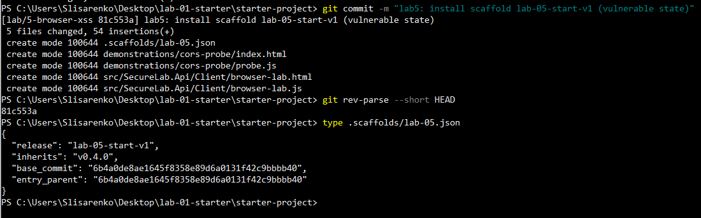

**Рис. 1.** Receipt scaffold lab-05-start-v1 і коміт вразливого стану

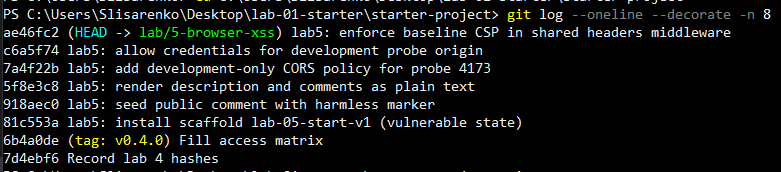

**Рис. 2.** Історія Git 

## Гіпотеза й REG-XSS-01

Повну карту потоку для Description і для коментаря наведено у файлі docs/source-to-sink.md.

### Гіпотеза та умови перевірки

Припускаємо, що значення поля description проходить увесь шлях без змін. Клієнт надсилає його POST-запитом, сервер зберігає його в Incident.Description і повертає в полі description відповіді GET, а клієнт передає цей рядок у innerHTML елемента #description. Якщо це так, розмітка в описі виконуватиметься в браузері кожного, хто відкриє інцидент, адже браузер не відрізняє такий рядок від коду сторінки.

Для перевірки використано трьох користувачів: Alice (Reporter) створює записи, Morgan (Analyst) їх читає, а Bob (Reporter) слугує негативним контролем. Marker береться з файла resources/lab05-marker.txt. Він лише встановлює атрибут data-lab05-marker зі значенням executed на службовому елементі #lab05-marker-target, не звертається до зовнішніх адрес і не читає credentials. Запис для перевірки опису має Guid af258e34-d4f9-4e9f-b64e-8cc3282ce3b0. Перед кожною серією спроб я скидала дані командою `dotnet run --project src/SecureLab.Api -- --reset-database` і запускала API командою `dotnet run --project src/SecureLab.Api`. Інцидент створювала й читала через форму "Створити й прочитати" та кнопку "Прочитати" на сторінці /browser-lab.html. Результат перевіряла виразом `document.querySelector("#lab05-marker-target").getAttribute("data-lab05-marker")`, який до читання запису має повертати null.

### Стан до виправлення

Спершу я переконалася, що без втручання все працює: сторінка показує назву, опис і коментар seed-інциденту, а GET повертає 200. Звичайні рядки з апострофом, лапками, символами "менше" та "більше" й Unicode виводилися правильно. Натомість рядок `<b>жирний</b> текст` перетворився на жирне слово без тегів (рис. 6), і це вже першою ознакою показало, що опис розбирається як HTML. Довгий рядок із 3900 символів сервер прийняв і повернув без змін; межа за правилами ЛР 2 становить 4000 символів.

Для коментаря в клієнті немає форми, тому я додала в seed публічний коментар із marker (коміт 918aec0). Коли Alice відкрила seed-інцидент, перевірка до читання повернула null, а після читання `'executed'`, і в Elements у блоці #comments з'явився елемент img (рис. 3). Для опису Alice створила інцидент із marker, а Morgan у режимі інкогніто відкрив той самий Guid: до читання перевірка дала null, після читання `'executed'` (рис. 4). У JSON відповіді значення лежить дослівно (рис. 5). Отже, код, введений одним користувачем, виконався в сеансі іншого.

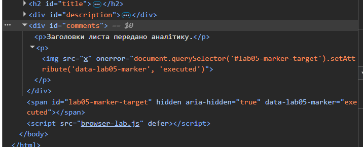

**Рис. 3.** До fix: елемент img усередині #comments, marker виконано

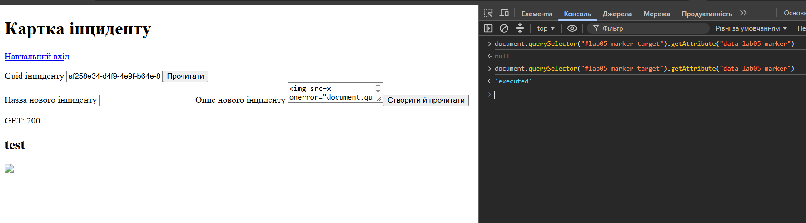

**Рис. 4.** До fix: Morgan відкриває запис Alice, marker виконано (null, потім executed)

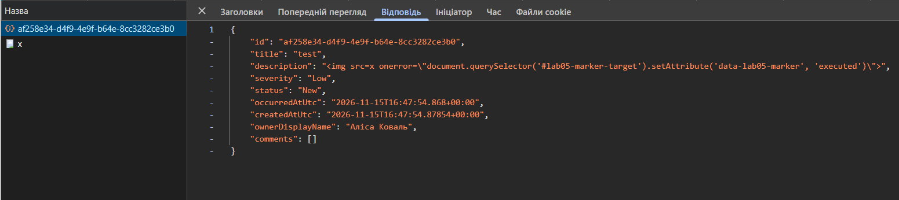

**Рис. 5.** До fix: JSON відповіді з marker в описі

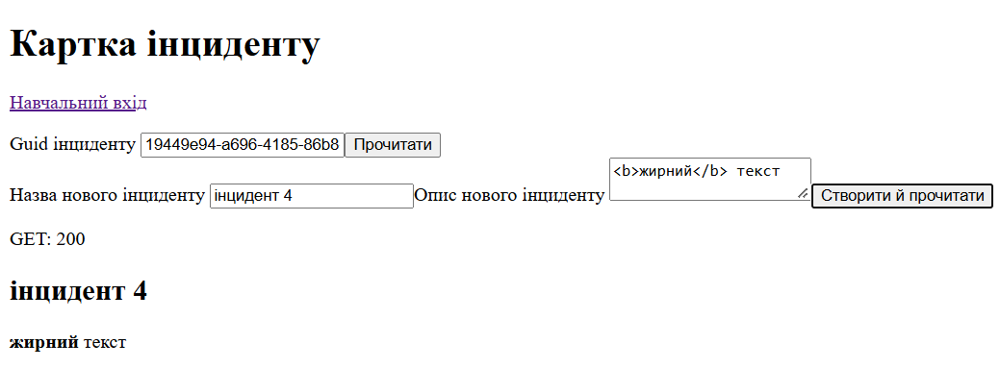

**Рис. 6.** До fix: HTML-подібний рядок стає розміткою

### Виправлення та повторна перевірка

У функції load() я замінила два рядки з `innerHTML` на виклик одного helper renderPlainText, який записує значення через textContent (коміт 5f8e3c8, рис. 2). Після цього опис у вікні Morgan відображається звичайним текстом, а перевірка marker повертає null (рис. 7). В Elements у #description лежить один текстовий вузол (рис. 8), і JSON відповіді збігається з тим, який був до виправлення (рис. 9). Так само поводиться коментар: у #comments тепер текстовий вузол (рис. 10), а перевірка повертає null (рис. 11).

Звичайні рядки після виправлення відображаються правильно: `<b>жирний</b> текст` разом із тегами (рис. 12), апостроф, лапки та Unicode в описі (рис. 13) і довгий рядок (рис. 14). Bob на запис Alice отримує відповідь 403, і marker у нього не виконується (рис. 15).

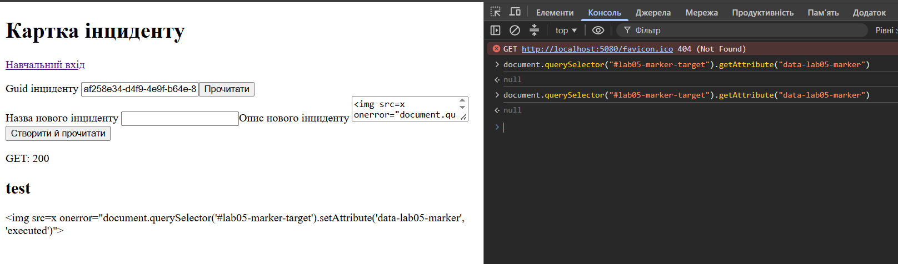

**Рис. 7.** Після fix: Description показано текстом, перевірка marker дає null

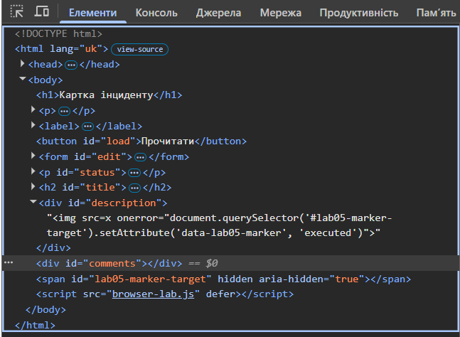

**Рис. 8.** Після fix: у #description один текстовий вузол

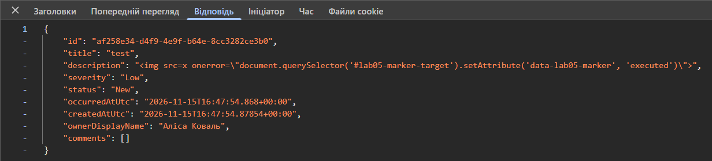

**Рис. 9.** Після fix: JSON відповіді не змінився

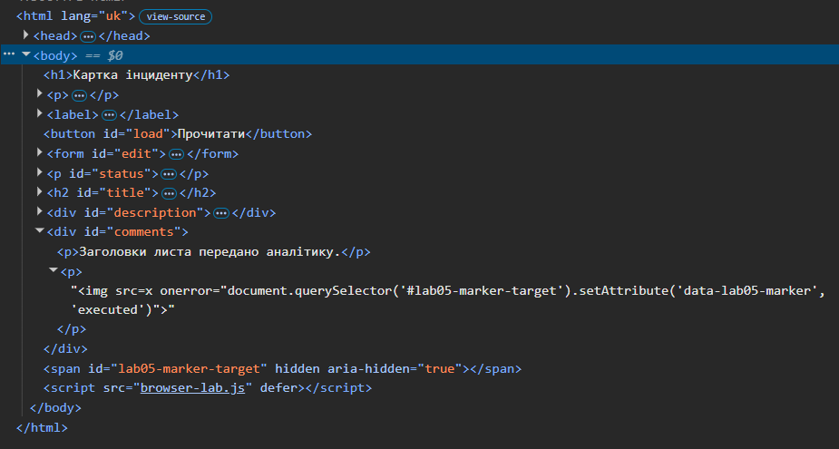

**Рис. 10.** Після fix: у #comments текстовий вузол

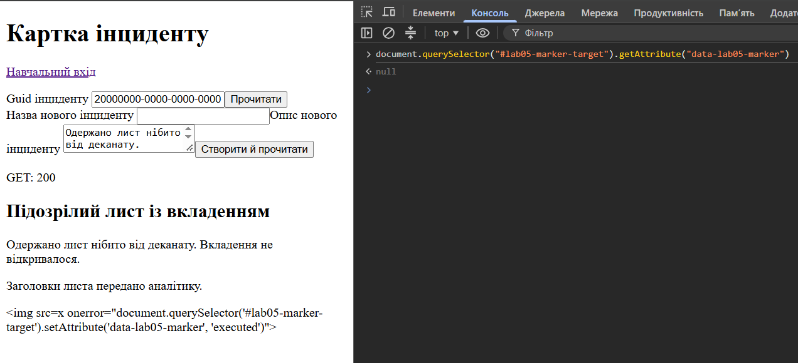

**Рис. 11.** Після fix: marker у коментарі не виконується


**Рис. 12.** Після fix: HTML-подібний рядок виведено як текст

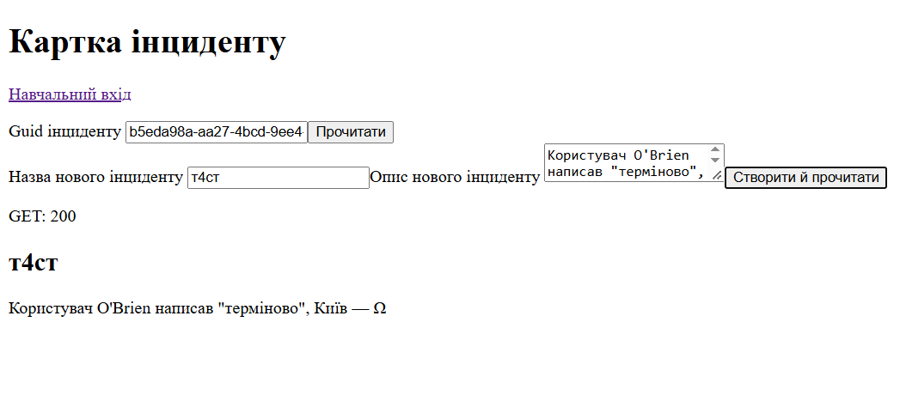

**Рис. 13.** Після fix: апостроф, лапки й Unicode в описі

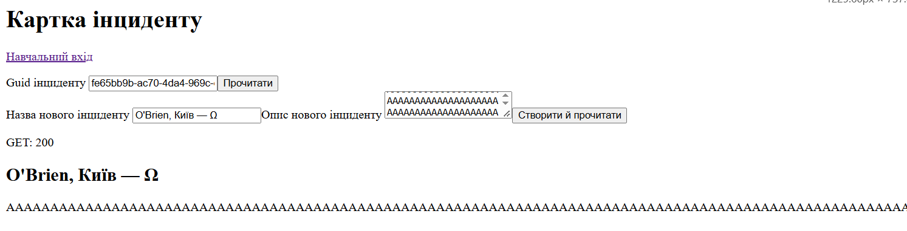

**Рис. 14.** Після fix: довгий рядок

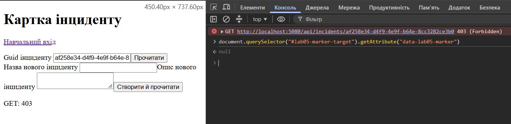

**Рис. 15.** Контроль Bob: 403, marker не виконується

Підсумок спостережень зведено в таблиці.

| Спостереження | До fix | Після fix | Посилання на доказ |
|---|---|---|---|
| Значення в БД/API | У JSON поле description містить marker дослівно | Те саме значення без змін | рис. 5, 9 |
| DOM основного Description | Marker виконується, у DOM елемент img | Один текстовий вузол із рядком marker | рис. 4, 7, 8 |
| Дія marker | null до читання, 'executed' після | null до й після читання | рис. 4, 7, 11 |
| Апостроф/лапки, 5 < 7, Unicode, HTML-like рядок | Звичайні рядки виводяться правильно, а `<b>жирний</b>` стає жирним словом без тегів | Усі рядки показано як текст, теги `<b>` видно | рис. 6 (до), 12, 13 (після) |
| Довжина за правилами ЛР 2 (межа 4000) | Рядок із 3900 символів збережено й показано без помилок (окремого рисунка не додаю) | Той самий рядок показано без пошкоджень | рис. 14 |
| Вікно Morgan: GET і перевірка marker; контроль Bob | Morgan: GET 200, 'executed'. Bob: 403 | Morgan: текст замість елемента, null. Bob: 403, null | рис. 4, 7, 15 |

### Finding

Під загрозою були поля Incident.Description та IncidentComment.Text, оскільки їх бачать інші користувачі. Умови для атаки створюють дві обставини. По-перше, Alice як Reporter може створити інцидент із довільним описом. По-друге, Morgan як Analyst за матрицею ЛР 4 читає чужі інциденти. Сервер при цьому поводиться передбачувано: він зберігає текст і повертає його без змін, а валідація з ЛР 2 перевіряє тільки обов'язковість і довжину.

Першопричина полягала в клієнтському коді: значення присвоювалося властивості `innerHTML`, тобто передавалося в контекст, який браузер розбирає як HTML. Тому виправлялося саме місце виведення, а не вхідне значення. У load() два рядки з `innerHTML` замінено викликом renderPlainText, що записує значення через `textContent`. Після цього marker і до, і після читання не виконується, у DOM лежать текстові вузли, а JSON відповіді не змінився (рис. 7–11).

Залишковий ризик я бачу в трьох речах. Виправлено два відомі sinks, а будь-який новий код із `innerHTML` знову відкриє цю проблему. Записи з розміткою в базі нікуди не зникли й лишаються безпечними лише доти, доки виводяться як текст. Нарешті, CSP працює як додатковий шар, а не як заміна виправлення, бо блокує inline-обробник незалежно від того, виправлений sink чи ні.

### REG-XSS-01 (повторювана перевірка)

Перевірка виконується на виправленому стані ae46fc2 після скидання бази, у Chrome, під користувачами Alice та Morgan. Вхідним значенням слугує marker з resources/lab05-marker.txt.

1. Увійти як Alice, створити інцидент із marker в описі й записати його Guid.
2. Увійти як Morgan у режимі інкогніто, відкрити /browser-lab.html, ввести Guid і виконати в Console перевірку атрибута (очікується null).
3. Натиснути "Прочитати", повторити перевірку (очікується null) і подивитися в Elements елемент #description, де має бути текстовий вузол.
4. Повторити пп. 2–3 для seed-інциденту 20000000-0000-0000-0000-000000000001 і його коментаря.
5. Створити запис зі звичайними рядками (`5 < 7`, `<b>жирний</b>`, апостроф, Unicode) і переконатися, що вони виводяться як текст.

Негативний контроль: на коміті 918aec0 (до виправлення) ті самі дії дають `'executed'`. Оскільки CSP блокує inline-обробник, висновок "sink виправлено" робиться за станом DOM, а не лише за тим, що marker не спрацював.

## CORS і REG-CORS-01

### Прогноз до зміни конфігурації

| Сценарій | Чи доходить request до API? | Чи може JavaScript прочитати response? | Чому |
|---|---|---|---|
| same-origin 5080 -> API | так | так | той самий origin, CORS не потрібен |
| simple GET 4173 -> API | так | ні, без valid CORS | правило браузера SOP/CORS |
| simple GET 4174 -> API | так | ні, origin не входить до allowlist | правило браузера SOP/CORS |
| curl/.http -> API | так | не застосовується | це не JavaScript у браузері |
| preflighted 4173 -> API | спочатку надходить OPTIONS, а доля actual-запиту залежить від відповіді | ні, без успішного preflight | preflight і CORS |

### Конфігурація й спостереження

Policy Lab05BrowserProbe реєструється лише в Development. Вона дозволяє єдиний точний origin http://localhost:4173, метод GET і заголовок X-Lab-Cors-Probe, а origin 4174 залишається негативним контролем. Команди запуску probes наведено в розділі про стенд.

До додавання policy запит на 5080 з того самого origin повертає 200 (рис. 16). З probe 4173 простий запит завершується помилкою про відсутній Access-Control-Allow-Origin, хоча запит до API дійшов і сервер відповів 200: браузер просто не передав відповідь скрипту. Запит із заголовком X-Lab-Cors-Probe відхиляється ще на етапі preflight (рис. 17). З probe 4174 до policy я спостерігала ту саму помилку, окремого рисунка для неї не додаю.

Після додавання policy з 4173 проходять і простий запит, і запит із заголовком (рис. 18). Помилка у верхньому рядку цього рисунка належить окремому досліду з credentials, про який нижче. З 4174 обидва запити відхиляються (рис. 19). Preflight для 4173 завершується відповіддю 204 із заголовками Access-Control-Allow-Origin, -Methods, -Headers та -Credentials (рис. 20). Для 4174 статус відповіді теж 204, але жодного CORS-заголовка в ній немає, тому основний запит узагалі не надсилається (рис. 21). Оскільки статус в обох випадках однаковий, я оцінювала результат за заголовками, а не за кодом відповіді.

| Клієнт / простий запит | До policy | Fixed state | Status, ACAO, Console / доказ |
|---|---|---|---|
| Same-origin 5080 | 200 | 200 | `fetch("/health")` повертає 200 (рис. 16) |
| Allowed 4173 | помилка CORS, запит до API дійшов | 200, ACAO = http://localhost:4173 | рис. 17 (до), 18, 20 (після) |
| Disallowed 4174 | та сама помилка | помилка лишається, ACAO відсутній | рис. 19, 21 (після) |
| Direct HTTP / curl | 200 без CORS-заголовків | 200; для Origin 4173 є ACAO і ACAC, для 4174 жодного Access-Control-* | рис. 26 |

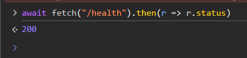

**Рис. 16.** Same-origin запит на 5080

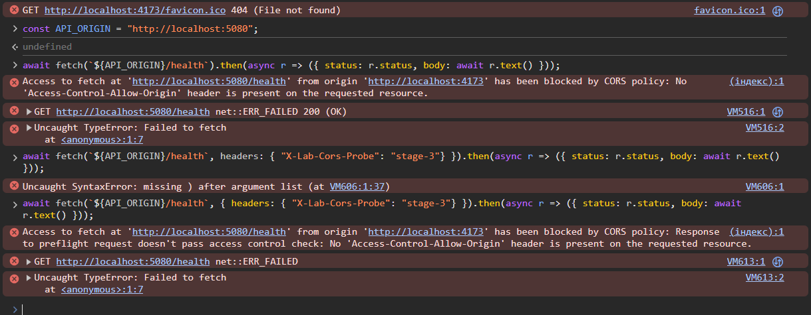

**Рис. 17.** До policy: probe 4173, помилка CORS у Console

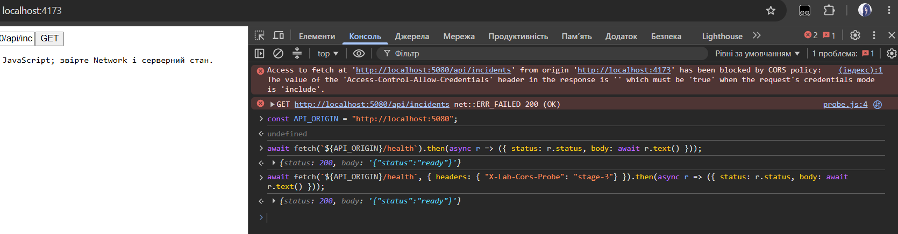

**Рис. 18.** Після policy: probe 4173, запити проходять

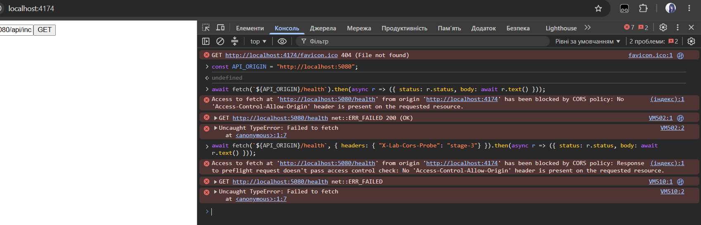

**Рис. 19.** Після policy: probe 4174, запити відхиляються

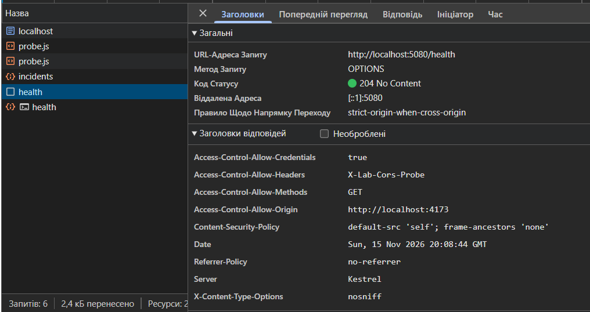

**Рис. 20.** Preflight із 4173: OPTIONS 204 із CORS-заголовками

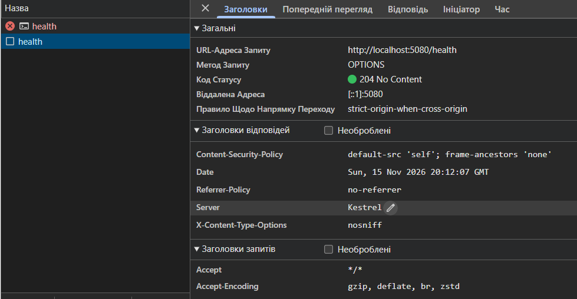

**Рис. 21.** Preflight із 4174: OPTIONS 204 без CORS-заголовків

Порядок middleware я перевірила окремо. Запит з probe 4173 без cross-origin cookie повертає 401, і JavaScript може прочитати саме цю відмову (рис. 22). Отже, CORS-заголовки додаються ще до автентифікації та авторизації. Червоний рядок про 401 у Console є повідомленням браузера про HTTP-відмову, а не помилкою CORS.

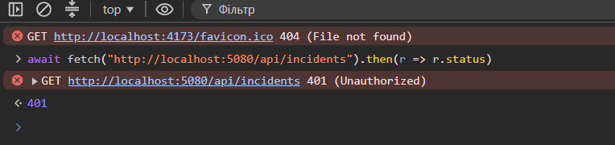

**Рис. 22.** Читання 401 без cross-origin cookie

### REG-CORS-01

Перша частина перевірки стосується браузера: на рис. 18 запит з дозволеного origin 4173 проходить, а на рис. 19 запит з 4174 відхиляється; у Network обидва запити йдуть на абсолютну адресу http://localhost:5080 і містять заголовок Origin. Друга частина стосується прямих HTTP-запитів до API на виправленому стані ae46fc2 (рис. 26). Повний текст відповідей наведено нижче.

```
Origin 4173: HTTP/1.1 200 OK
Access-Control-Allow-Credentials: true
Access-Control-Allow-Origin: http://localhost:4173
X-Content-Type-Options: nosniff
Referrer-Policy: no-referrer
Content-Security-Policy: default-src 'self'; frame-ancestors 'none'

Origin 4174: HTTP/1.1 200 OK
X-Content-Type-Options: nosniff
Referrer-Policy: no-referrer
Content-Security-Policy: default-src 'self'; frame-ancestors 'none'
```

Різниця між браузером і curl пояснюється тим, що same-origin policy та CORS є правилами браузера для веб-вмісту. Curl не є браузером, тому читає відповідь незалежно від значення Origin. Сервер в обох випадках виконав запит і застосував однакові перевірки автентифікації й авторизації. У випадку origin 4174 браузер лише не передає відповідь скрипту сторінки.

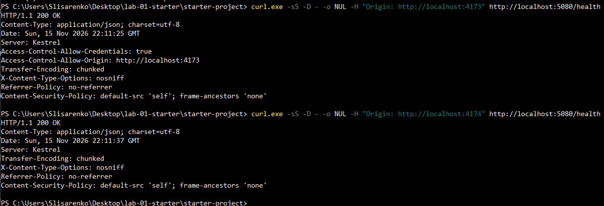

**Рис. 26.** REG-CORS-01: curl з Origin 4173 і 4174 на fixed-стані

## Додатково для Добре

### Другий потік і єдиний helper

Другим полем я перевіряла IncidentComment.Text. Для цього в seed додано публічний коментар Guid 30000000-0000-0000-0000-000000000005 до інциденту 20000000-0000-0000-0000-000000000001 (коміт 918aec0). До виправлення в #comments з'являвся елемент img і marker виконувався (рис. 3), після виправлення там текстовий вузол, а перевірка повертає null (рис. 10, 11). Обидва поля тепер виводить один helper:

```js
function renderPlainText(target, text) {
  target.textContent = text;
  return target;
}
```

Його викликано і для #description, і для кожного елемента p у #comments (коміт 5f8e3c8).

### Preflight і дослід із cookie

Результати preflight з обох origin наведено на рис. 20 і 21. Запит із заголовком X-Lab-Cors-Probe після налаштування policy проходить з 4173 (рис. 18) і не проходить з 4174 (рис. 19).

Дослід із cookie я виконувала після входу Alice. З probe 4173 і з увімкненим AllowCredentials запит повертає 200 зі списком інцидентів, а у відповіді присутні Access-Control-Allow-Origin = http://localhost:4173 та Access-Control-Allow-Credentials: true (рис. 23). З probe 4174 запит до API надходить і отримує 200, але браузер не передає відповідь скрипту (рис. 24). Оскільки без cookie цей маршрут повертає 401, статус 200 означає, що сервер виконав запит від імені Alice. Без AllowCredentials запит з 4173 відхиляється з повідомленням про заголовок Access-Control-Allow-Credentials (рис. 25), а без входу читається відмова 401 (рис. 22). У підсумковому стані AllowCredentials() лишається тільки в Development-policy для origin 4173. Порівняння XSS, CORS, CSRF та авторизації наведено у звіті DEL-03.

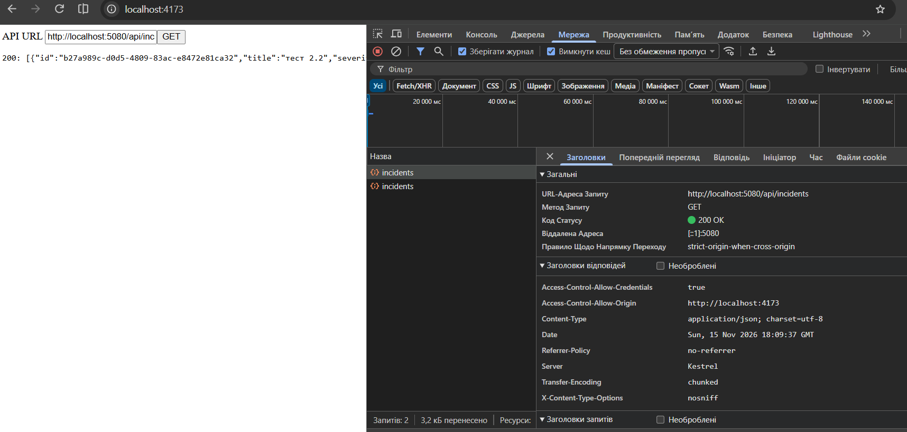

**Рис. 23.** 4173 із AllowCredentials: 200, ACAO і ACAC

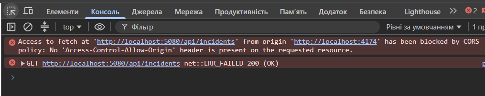

**Рис. 24.** 4174: запит виконано (200), відповідь не надано скрипту

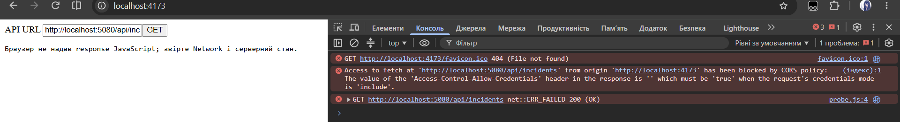

**Рис. 25.** Без AllowCredentials: помилка заголовка Access-Control-Allow-Credentials

### Content-Security-Policy

Перш ніж писати політику, встановлено, що саме завантажує застосунок. Усі ресурси (документи, styles.css, app.js, browser-lab.js, auth-lab.js та запити incidents і me) надходять із localhost:5080 (рис. 27). Зображень немає, якщо не враховувати inline-іконку `data:` на сторінці auth-lab.html і запит favicon.ico, який повертає 404. Тому політика складається з джерела 'self' і директиви frame-ancestors 'none'.

| Директива CSP | Фактичні ресурси застосунку | Обране джерело / причина |
|---|---|---|
| default-src | усе завантажується з власного origin (рис. 27) | 'self' |
| script-src | app.js, browser-lab.js, auth-lab.js; inline-скриптів на сторінках flow немає | 'self' через default-src |
| style-src | styles.css; inline-стилів на сторінках flow немає | 'self' через default-src |
| connect-src | fetch-запити incidents і me на тому самому origin | 'self' через default-src |
| img-src | зображень немає; favicon.ico повертає 404, inline-іконка `data:` порушень не викликає | 'self' через default-src |
| frame-ancestors | вбудовування застосунку не потрібне; директива не має запасного значення з default-src | 'none' |

Зміну внесено в Program.cs, у наявну спільну middleware заголовків: змінна csp (рядок 55) і запис заголовка (рядок 68), а для шляху /scalar у Development залишено виняток. У режимі enforcement документ повертає 200 і заголовок `Content-Security-Policy: default-src 'self'; frame-ancestors 'none'` (рис. 28). На сторінках `/browser-lab.html` та `/auth-lab.html` Console не містить повідомлень CSP, лишається лише favicon.ico 404 (рис. 29 і 30); сторінку `/` я перевіряла так само, окремого рисунка для неї не додаю. Кероване порушення `new Image().src = "http://localhost:4173/x.png"` заблоковано, і повідомлення закінчується словами «The action has been blocked» (рис. 30). Підсумковий прогін тестів завершився результатом 45 з 45 (рис. 31).

Сторінки probe-check.html і register-check.html з ЛР 2–3 мають inline-стилі, тому під цією політикою втратять оформлення, але до сценарію ЛР 5 вони не належать.

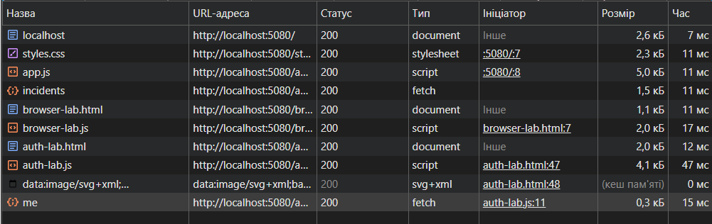

**Рис. 27.** Network: усі ресурси клієнта з localhost:5080

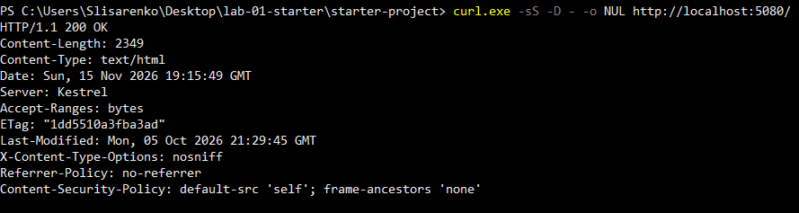

**Рис. 28.** Фактичний CSP header у відповіді

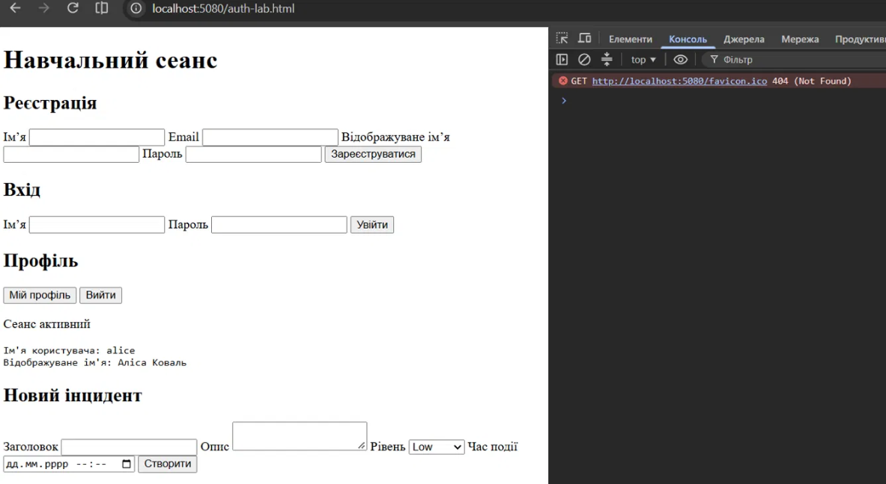

**Рис. 29.** Сторінка auth-lab.html під CSP: Console без порушень

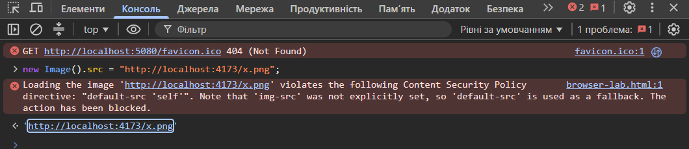

**Рис. 30.** Кероване порушення заблоковано

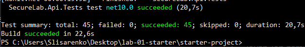

**Рис. 31.** Підсумковий прогін тестів: 45 з 45

### Заголовки відповіді

| Header / control | Фактичне значення | Ризик і межа захисту / policy rationale |
|---|---|---|
| X-Content-Type-Options | nosniff (рис. 28) | Не дає браузеру вгадувати тип вмісту. Не замінює правильний Content-Type і валідацію. |
| Referrer-Policy | no-referrer (рис. 28) | Не передає адресу сторінки з ідентифікаторами іншим сайтам. Клієнту переходи на сторонні origins не потрібні, тому політика підходить. Не скасовує заборони розміщувати секрети в URL. |
| frame-ancestors | 'none' (рис. 28) | Забороняє вбудовувати застосунок в інші сторінки й зменшує ризик clickjacking. Не замінює авторизацію та виправлення XSS. |