# Звіт ЛР04. Авторизація, ролі та IDOR/BOLA

## Контекст і межа виконання

- Рівень: добрий («Добре»). Я закрила весь периметр Incident: список, деталі, update, delete, triage, коментар через окремий endpoint, internal comment і аудит відмови. Search і severity-summary (рівень «Відмінно») не чіпала.
- Baseline 2-A. Почала від тега `v0.3.0`, його hash `5b8d06440f21754bfaeaf5806ed1790316d082cf`. Гілка `lab/4-authorization`.
- Головна action: `GET /api/incidents/{id}`.
- Політика відмов, одна на всі endpoint-и: анонім отримує 401, автентифікований без права на існуючий інцидент отримує 403, неіснуючий id дає 404. Обрала 403, бо сам факт існування інциденту не секретний, а явна відмова простіша і для клієнта, і для тестів. Через це A-10 не застосовується.
- ЛР 3 після тега не виправляла, тег не пересувала.

## Матриця і server-side рішення

Повна матриця в `docs/access-matrix.md`. Коротко по правилах:

- Читання інциденту: власник або Analyst.
- Update і delete: лише власник з роллю Reporter. Analyst читає, але не змінює і не видаляє.
- Triage: лише Analyst і лише для інциденту у статусі New. Новий статус (Triaged) ставить сервер, клієнт його не передає. Якщо інцидент уже не New, відповідь 409.
- Administrator прав на Incident не має, бо в предметному правилі їх прямо не названо. Створення інциденту лишилось успадкованим baseline з ЛР 3.
- Internal comment бачить Analyst. Reporter не бачить його ні в деталях, ні через прямий id.

Де це в коді:

- усі правила в одному місці: `IncidentAuthorizationHandler` (`Application/Incidents/IncidentAuthorization.cs`);
- список: обмеження прямо в запиті (`IncidentQueries.GetListAsync`), чужі рядки з бази не читаються;
- update приймає лише `UpdateIncidentRequest` (title, description, severity, occurredAtUtc), тож owner, status і role з тіла просто не беруться;
- id користувача скрізь береться з claim у cookie, ніколи з тіла чи URL.

## Вразливий стан і PoC

Vulnerable commit: `84a6bfeefb80aa3677409bfc7b2dbe270bbcd821`.

Alice читає свій інцидент і отримує 200. Далі я змінила в запиті лише id на інцидент Bob, cookie ті самі, і теж отримала 200 з даними Bob (назва "Невідома спроба входу", автор "Боб Мельник"). Це - IDOR/BOLA: сервер перевіряв тільки наявність запису, а не чий він.

Окремо: той самий запит без жодної cookie теж повернув 200 з повним JSON. Тобто маршрут на той момент взагалі не вимагав автентифікації.

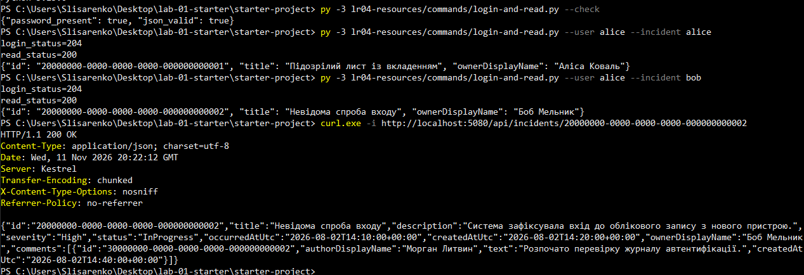

**Рис. 1.** Alice читає свій інцидент і інцидент Bob, анонімний запит до інциденту Bob

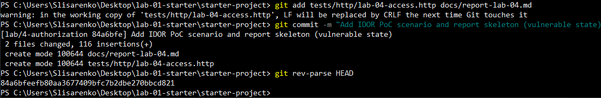

**Рис. 2.** Коміт вразливого стану

## Виправлення та retest

Fixed commit: `777f3600eeefa5d12e2c7e3148a638c879f7e0bf`.

Після виправлення ті самі запити дають:

| Запит | Результат |
|---|---|
| Alice -> свій інцидент | 200 |
| Alice -> інцидент Bob | 403, у тілі лише `title: Forbidden` і `traceId` |
| Morgan (Analyst) -> інцидент Alice | 200 |
| Анонім -> інцидент Bob | 401 |

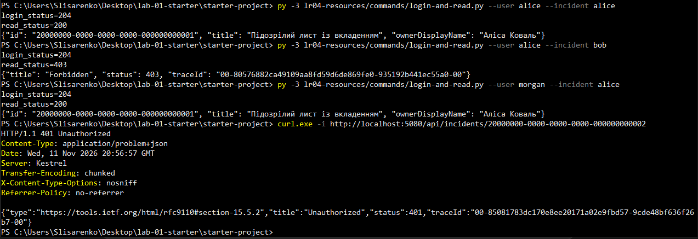

**Рис. 3.** Повторний PoC після виправлення

Коли я додала `RequireAuthorization()` на групу маршрутів, три старі тести з ЛР 1 впали з 401, бо ходили анонімним клієнтом. Це очікувана зміна контракту, а не поломка. Я переписала їх на клієнта після login, а перевірку списку замінила на перевірку, що чужих записів у ньому немає.

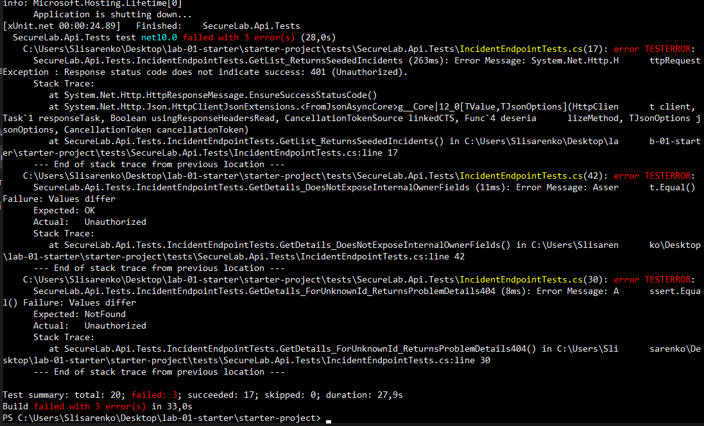

**Рис. 4.** Три старі анонімні тести впали з 401

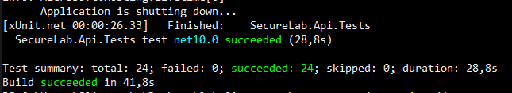

**Рис. 5.** Після переписування тестів: 24 з 24

Для змінювальних дій я перевіряла не лише код відмови, а й стан після нього: перед запитом читаю ресурс власником, надсилаю заборонений запит, читаю знову і порівнюю. Так перевірені update чужого, delete чужого і triage від Reporter. Тести створюють власні інциденти й прибирають їх, тому seed-дані не псуються.

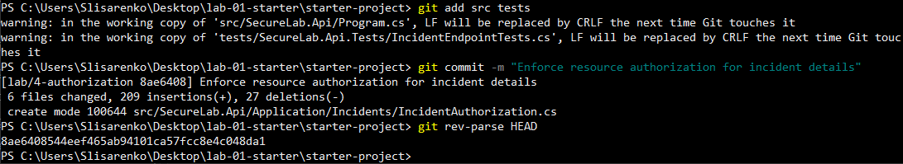

**Рис. 6.** Коміт із захистом деталей

## Доказова таблиця

Усі рядки нижче пройшли в автоматичних тестах (підсумок: 45 з 45).

| ID | Рівень | Сценарій | Передумови | Дія | Очікувано | Фактично | Доказ |
|---|---|---|---|---|---|---|---|
| A-01 | добрий | Анонімний доступ | немає cookie | GET деталей | 401, без redirect | 401, заголовка Location немає, не HTML | тест [GetDetails_Anonymous_Returns401_NotRedirect](evidence/GetDetails_Anonymous.png) |
| A-02 | достатній | Власний ресурс | Alice, її інцидент | GET деталей | allow | 200, id збігається | тест [GetDetails_AsOwner_ReturnsOwnIncident](evidence/GetDetails_AsOwner.png) |
| A-03 | достатній | Чужий ресурс | Alice, інцидент Bob | GET деталей з чужим id | 403 | 403, назви й імені Bob у тілі немає | тест [GetDetails_AsNonOwner_Returns403_AndDoesNotLeakData](evidence/GetDetails_AsNonOwner.png) |
| A-03R | достатній | Аналітичний read | Morgan, інцидент Alice | GET деталей | allow | 200 | тест [GetDetails_AsAnalyst_ReturnsForeignIncident](evidence/GetDetails_AsAnalyst.png) |
| A-04 | добрий | Чужий ресурс, update і delete | Alice, Bob | PUT і DELETE з чужим id | deny, стан без змін | 403, дані до і після однакові, інцидент на місці | тести [Update_AsNonOwner_...](evidence/Update_AsNonOwner.png), [Delete_AsNonOwner_...](evidence/Delete_AsNonOwner.png) |
| A-05 | добрий | Список | Alice | GET списку | лише дозволена множина | свої є, чужих немає; Morgan бачить усіх | тести [GetList_AsReporter_...](evidence/GetList_AsReporter.png), [GetList_AsAnalyst_...](evidence/GetList_AsAnalyst.png) |
| A-06 | добрий | Вертикальне підвищення | Alice (Reporter) | POST triage | deny, статус без змін | 403, статус лишився New | тест [Triage_AsReporter_IsDenied_AndDoesNotChangeStatus](evidence/Triage_AsReporter.png) |
| A-07 | добрий | Дозволена привілейована дія | Morgan, інцидент New | POST triage | allow | 204, статус став Triaged | тест [Triage_AsAnalyst_ChangesStatusToTriaged](evidence/Triage_AsAnalyst.png) |
| A-08a | добрий | Надлишкове присвоєння | Alice | PUT із зайвими `ownerUserId`, `status`, `role` | зайве ігнорується | 204, назва змінилась, власник і статус ні | тест [Update_WithForgedFields_IgnoresOwnerStatusAndRole](evidence/Update_WithForgedFields.png) |
| A-08b | добрий | не обрала | | | | не виконувалось: обрала варіант A-08a | |
| A-09 | добрий | Audit відмови | Alice, triage | знайти `authorization.denied` | подія без секретів | є subject, action, resource, result, час UTC, traceId; пароля, cookie і тіла запиту немає | [auth_denied](evidence/a09-auth_denied1.png) і [log_auth_denied](evidence/a09-auth_denied2.png) |
| A-10 | добрий, лише 404 | Нерозрізнюваність 404 | | | | не застосовується: обрана політика 403 | обґрунтування вище |
| A-11 | відмінний | search і severity-summary | | | | не виконувалось: рівень відмінний | |
| A-12 | добрий | Child і internal comment | Alice | прямий id коментаря до інциденту Bob; internal коментар до свого інциденту | deny | 403 в обох випадках, тексту в тілі немає; у деталях Alice internal-коментаря немає, у Morgan є | тести [GetComment_AsReporter_ForeignComment_...](evidence/GetComment_AsReporter.png), [GetComment_AsOwner_InternalComment_...](evidence/GetComment_AsOwner.png), [Details_AsOwner_DoesNotContainInternalComment](evidence/Details_AsOwner.png), [Details_AsAnalyst_ContainsInternalComment](evidence/Details_AsAnalyst.png) |

## Основний finding і залишковий ризик

**Контекст.** Ресурс Incident, дія читання, суб'єкти Alice і Bob (обидва Reporter) та Morgan (Analyst).

**Гіпотеза.** Alice зможе прочитати інцидент Bob, якщо підмінить id в URL.

**Стан до.** Гіпотеза підтвердилась (рис. 1, коміт `84a6bfe`).

**Першопричина.** Запит у `GetDetailsAsync` шукав інцидент лише за `id`. Endpoint не читав поточного користувача і не порівнював його з власником, а група маршрутів не мала `RequireAuthorization()`. Тобто бракувало і автентифікації на маршруті, і рішення про право на конкретний ресурс. Сам id в URL проблемою не був.

**Виправлення.** Група маршрутів вимагає автентифікації. Endpoint спершу знаходить інцидент (немає такого, то 404), потім питає handler, чи може цей користувач виконати цю дію над цим інцидентом (ні, то 403), і лише після цього повертає дані або змінює стан. Правила всіх ролей зібрані в одному handler, щоб не розкидати умови по endpoint-ах. Для списку обмеження вбудоване прямо в запит.

**Retest.** Той самий запит Alice -> Bob тепер дає 403, дані Bob у відповідь не потрапляють (рис. 3).

**Позитивна регресія.** Alice далі читає і змінює власні інциденти, Morgan читає чужі для аналізу.

**Залишковий ризик.**

- `search` і `severity-summary` досі не обмежені за суб'єктом: їх закриває рівень Відмінно», я його не робила.
- CSRF для cookie-автентифікації лишається задокументованим боргом ЛР 3 до ЛР 6.
- Administrator може створювати інциденти, бо створення я лишила успадкованим baseline.
- Захисту від одночасних переходів статусу немає.
- Через політику 403 Alice може за відповіддю відрізнити існуючий чужий інцидент від неіснуючого. Для цього проєкту я це прийняла свідомо.

## Browser flow

Увійшла як alice на `auth-lab.html`, перейшла на головну. У списку лише її інциденти. Деталі власного інциденту відображаються нормально (рис. 7). Потім у консолі вручну викликала `loadIncidentDetails` з id інциденту Bob, і в блоці деталей з'явилося "Помилка: Forbidden" (рис. 8). Клієнт тільки показує відповідь сервера: дані виводяться через `textContent` і `createTextElement`, `innerHTML` у коді немає (є тест на це).

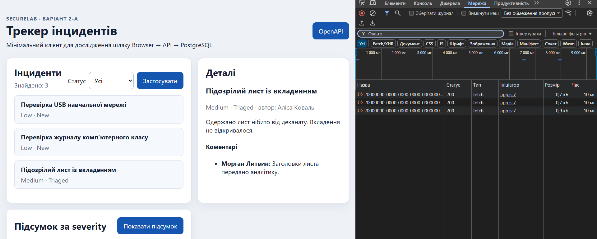

**Рис. 7.** Деталі власного інциденту Alice

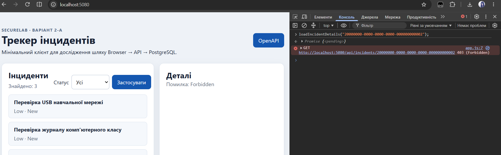

**Рис. 8.** Повідомлення відмови для інциденту Bob

## Роль, transition, child, audit

- Triage дозволений лише Analyst, і лише для статусу New. Reporter отримує 403 (навіть для власного інциденту), повторний triage вже обробленого інциденту дає 409. Наступний статус сервер ставить сам.
- Коментар Morgan до інциденту Bob (comment-2) Alice за прямим id не читає. Internal comment (comment-3, до інциденту Alice) не бачить навіть власниця, а Morgan бачить.
- Audit: рядок `authorization.denied` містить subject, action `incident.triage`, resource, result `denied`, час UTC і `traceId`. Значення `traceId` в рядку з консолі API і в тілі відповіді 403 однакове (`00-3f513c4c4a54462b858f352a04e39251-2df62eceb520c705-00`). Cookie, пароля і тіла запиту в події немає.

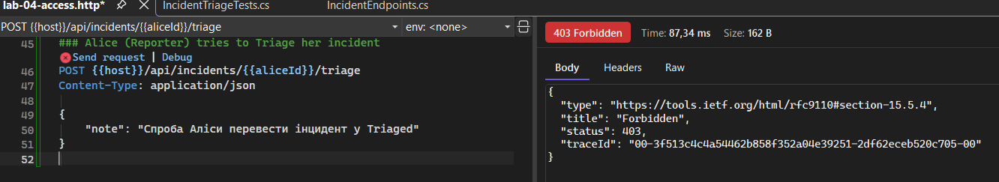

**Рис. 9.** Відповідь 403 на triage від Alice

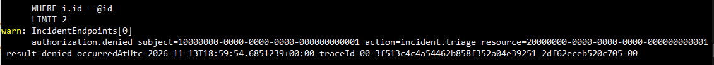

**Рис. 10.** Рядок аудиту в консолі API з тим самим traceId

## Перевірки, відтворення і подання

- Середовище: Windows, .NET 10, PostgreSQL у Docker.
- Команди: `docker compose --env-file infra/.env.example -f infra/compose.yaml up -d --wait`, потім `dotnet run --project src/SecureLab.Api -- --reset-database`, потім `dotnet test tests/SecureLab.Api.Tests/SecureLab.Api.Tests.csproj --configuration Release`.
- Результат: `total: 45; failed: 0; succeeded: 45`. Перед цим тести проходили поступово: 24, 26, 33, 35, 37.
- Ручні запити після reset дали 200, 403, 200, 401 (рис. 3).
- Hash тега `v0.4.0` (він же fixed commit): `777f3600eeefa5d12e2c7e3148a638c879f7e0bf`.
- Гілка `lab/4-authorization`, посилання на репозиторій: `https://github.com/miiiyori/MIYORIsecurelab-kb42`.
- Не виконувалось: A-08b, A-10, A-11, перевірка одночасних переходів.

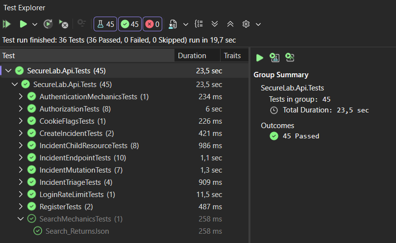

**Рис. 11.** Підсумок фінального прогону тестів

## Використання ШІ

Використовувала Claude як помічника: він давав чернетки коду й пояснення, а я сама вставляла код, запускала й виправляла. Що я перевіряла самостійно: усі тести запускала сама, ручні запити робила в терміналі й браузері, вибір 403 і правила матриці зробила я. Помилки теж ловили на практиці: наприклад, API довго показував старий результат, бо не був перезапущений після змін, а ще я звіряла код із матрицею й змінювала child endpoint з 404 на 403, щоб політика була однакова всюди.

| Дата/інструмент | Для чого | Що використано | Що перевірено самостійно |
|---|---|---|---|
| 11-13.11.2026, Claude | чернетки handler-а, endpoint-ів і тестів | структура handler-а, endpoint-и update/delete/triage/child, тести | запуск усіх тестів, ручні запити, порівняння з матрицею |