# Звіт WEB ЛР 2

## 1. Ідентифікація

- ПІБ і група: Слісаренко Анастасія Володимирівна, КБ-42
- Спільний baseline 2-A; індивідуального номера немає.
- Заявлений рівень: добрий («Добре»)
- Гілка lab/2-input-sqli.
- Release, base_commit, entry_parent:  
	- release: lab-02-start-v1; 
	- base_commit: 3536ae3936683d23d83af958421e72be5c395585; 
	- entry_parent: 9b559c645f35a2296c33342dab06ab1655b5dfe0;

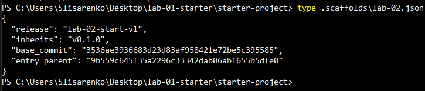
- Vulnerable commit: e5b2f8e3d0554a7896cbb9cc04606a32016a0af0. 

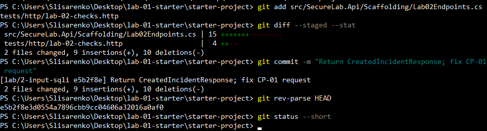
- Fixed commit коду: df501f9fb846d42ce1335d1524751e273ce376c8. 

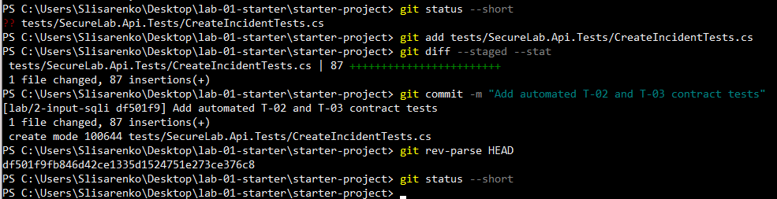
- Фінальний тег v0.2.0 на commit із завершеним звітом: v0.2.0 (створено після коміту цього звіту)
- DEL-01: URL приватного remote з доступом або ім’я переданого bundle: https://github.com/miiiyori/securelab-kb42/invitations

## 2. Контракт і CP-01

Реалізовано серверну валідацію вхідних даних для ендпоінту створення інцидентів (POST /api/incidents)
Створено новий DTO CreatedIncidentResponse, який обмежує дані, що повертаються клієнту (6 полів: Id, Title, Severity, Status, OccurredAtUtc, CreatedAtUtc).
Налаштовано базові перевірки: 
- title обов'язковий і не довший за 160 символів
- description обов'язковий і не довший за 4000 символів
- дата обов'язкова та не може бути пізніше ніж на 5 хвилин у майбутньому 
- severity перевіряється через Enum.TryParse Enum.IsDefined

Усі помилки контракту повертаються одним 400 у форматі Problem Details. 

Для рівня "Добре" додатково реалізовано: 
- T-09: для High та Critical опис після Trim() має містити щонайменше 40 символів
- T-03: повторний title активного інциденту (будь-який статус, окрім Closed) повертає 409 Conflict

Id, власника, статус New і час ставить сервер. У CP-01 я надіслала в тілі зайві поля (id, status Closed, ownerUserId) 
і перевірила через GET за Location: запис отримав новий id, статус New і власника "Аліса Коваль"
Відповідь на POST повертає CreatedIncidentResponse (шість полів). 

Докази: 

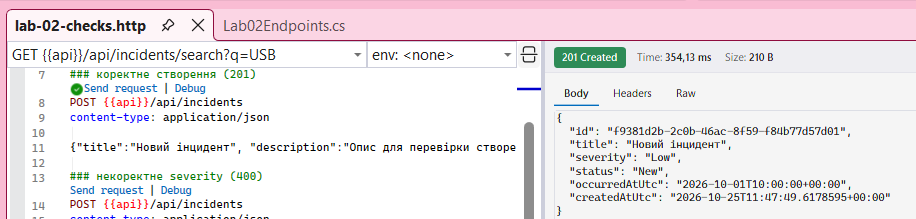

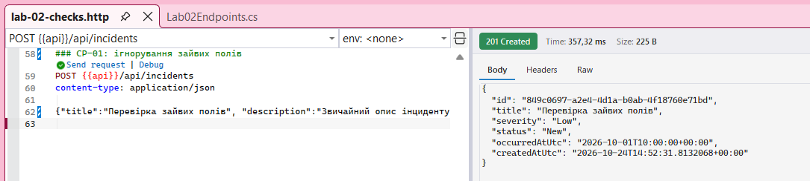 

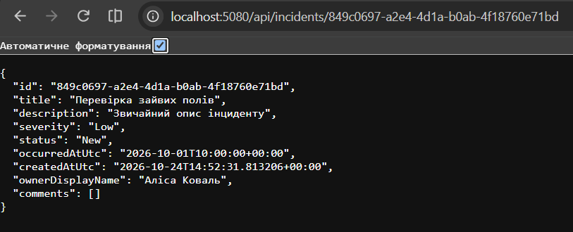

## 3. Security-сценарій і CP-02/CP-03

**Контекст**: Ендпоінт GET /api/incidents/search отримує q і sortBy від клієнта, тобто недовірені значення. Припущення: вони потрапляють у SQL-текст. 

**Стан до**: на vulnerable commit обробник MapGet("/api/incidents/search") у файлі Lab02Endpoints.cs збирав SQL конкатенацією (рядки 26-27) і виконував його через FromSqlRaw

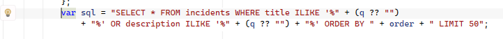

var sql = "SELECT * FROM incidents WHERE title ILIKE '%" + (q ?? "")
	 + "%' OR description ILIKE '%" + (q ?? "") + "%' ORDER BY " + order + " LIMIT 50";

окремо гілка '_ => sortBy' у switch передавала довільне значення в ORDER BY

**Локальний сценарій читання + спостереження**: використано лише read-only запити з tests/http/lab-02-checks.http.
звичайний пошук і значення без збігів поводилися нормально:

- A: дав один запис   

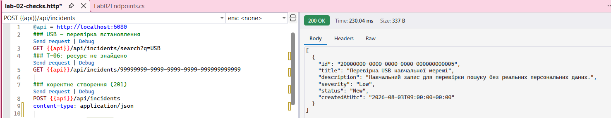
- B: порожній масив   

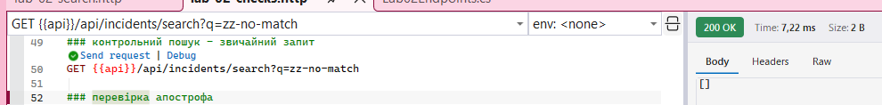
- C: апостроф у значенні закрив рядковий літерал, OR TRUE додав завжди істинну умову, а -- закоментував решту запиту разом з ORDER BY і LIMIT. Тому повернулись усі 5 записів

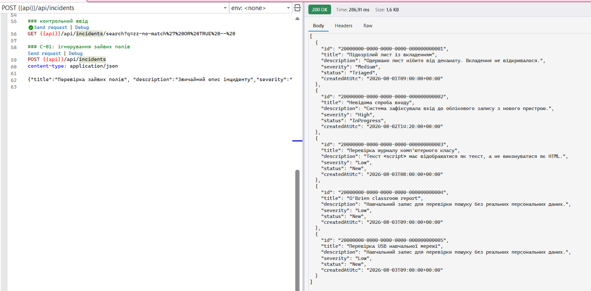
- D: апостроф в O'Brien закрив літерал після O, і Brien опинилося поза лапками. PostgreSQL повернув помилку синтаксису (42601), а клієнт побачив 500 без деталей

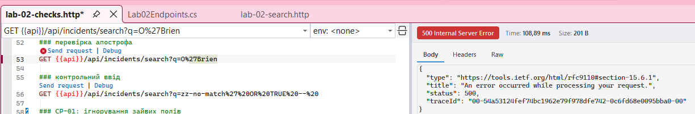

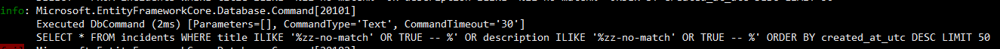

**Першопричина**: q і sortBy з'єднувалися із SQL-текстом до виконання, тому дані могли змінити структуру запиту

**Виправлення**: (df501f9) пошук переписано на LINQ з EF.Functions.ILike, шаблон іде параметром, а символи '%', '_' і '\' екрануються. 
сортування вибирається з allowlist (createdAtUtc, severity, status) з другим ключем Id, невідоме значення дає 400, 
вибірка обмежена Take(50), для severity і status сортування йде за рангом

**Retest і позитивна регресія**: на fixed commit:
- С повертає порожній масив  

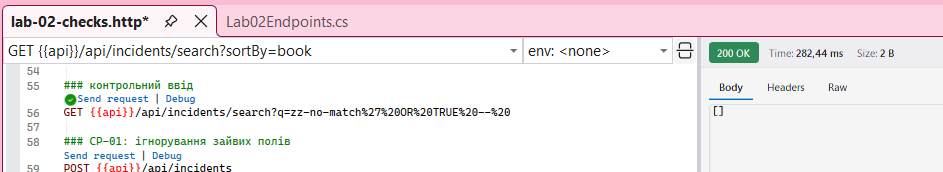
- D повертає запис "O'Brien classroom report"  

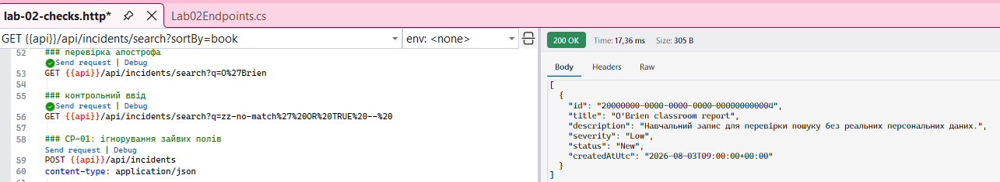
- пошук із апострофом у "комп'ютерного" знаходить один запис  

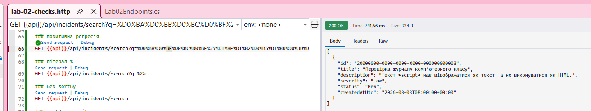
- '%' шукається як літерал і дає порожній масив  

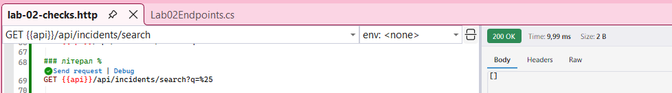
- у журналі тепер 'Parameters=[@pattern, @pattern0, @p]' і 'ILIKE @pattern ESCAPE '\''  

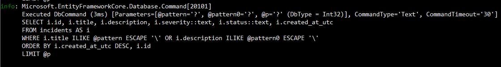

## 4. Фактичні перевірки DEL-02

| ID | Сценарій | Передумови | Дія | Очікувано | Фактично | Доказ |
|---|---|---|---|---|---|---|
| T-01 | Коректне створення | Очищена база, унікальний title | POST /api/incidents з валідним DTO | 201, response DTO без зайвих полів | Статус 201 Created. сервер повернув рівно 6 полів, у заголовку Location є посилання на новий запис | [t01](evidence/t01-created.png) |
| T-02 | Некоректний DTO | - | POST із полем severity "7" | 400 Bad Request у форматі Problem Details | Відбило з 400 помилкою, application/problem+json. є ключ errors.severity, системний стек не виводиться. Автотест пройдено | [t02](evidence/t02-severity.png), [tests](evidence/tests-created.png) |
| T-03 | Предметний конфлікт | В базі вже є активний інцидент з таким title | Повторний POST | 409 у Problem Details | Сервер видав 409 з повідомленням "Інцидент уже існує". Автотест пройдено | [t03](evidence/t03-conflict.png), [tests](evidence/tests-created.png) | 
| S-01 | SQLі до виправлення | Вразливий коміт, локальні дані| Контрольний read-only запит С | Небажано широка вибірка | Запит С вивів усі 5 записів замість порожнього результату. Запит D видав 500 помилку | [a](evidence/s01-a.png), [b](evidence/s01-b.png), [c](evidence/s01-c.png), [d](evidence/s01-d.png), [log](evidence/s01-log.png) |
| S-02 | Retest SQLі (після) | Виправлений коміт, та сама база | Той самий запит С | Порожній або обмежений результат | 200 OK, у відповіді порожній масив [ ] | [s02](evidence/s02-c.png) |
| T-04 | Позитивна регресія  | Виправлений коміт | Пошук "O'Brien" і "комп'ютерного" | Коректні записи, без 500 | 200 OK. Апостроф опрацювався нормально, знайшло по одному відповідному запису | [apostrophe](evidence/t04-apostrophe.png), [computer](evidence/t04-computer.png) |
| T-05 | Невідоме сортування | Виправлений коміт | sortBy=book | 400 помилка | 400 Bad Request, у errors.sortBy вивело список дозволених полів (createdAtUtc, severity, status) | [t05](evidence/t05-sortby.png) |
| T-06 | Ресурс не знайдено  | Відсутній id 9999... | GET /api/incidents/{id} | 404 Problem Details | 404 помилка, title "Інцидент не знайдено", є traceId | [t06](evidence/t06-notfound.png) |
| T-09 | Cross-field 2-A	 | Унікальний title | Два POST: High з описом 39 символів та 40 символів | 39 символів - 400; 40 символів - 201 | З 39 символами не пустило (400, errors.description). З 40 символами запис успішно створився (201) | [39](evidence/t09-39.png), [40](evidence/t09-40.png) |
| A-01 | Огляд data-access   | Виправлений коміт | git grep для FromSqlRaw, ExecuteSqlRaw, ORDER BY, SELECT | Вказати кожен збіг, категорію, висновок | Усі знайдені збіги та висновки розписані в таблиці нижче | [a01](evidence/a01-grep.png), [select](evidence/a01-grep-select.png) |

**Сортування на виправленому коміті спрацювало коректно:**
- без sortBy: порядок за часом створення від найновішого до старішого (0004, 0005, 0003, 0002, 0001) 

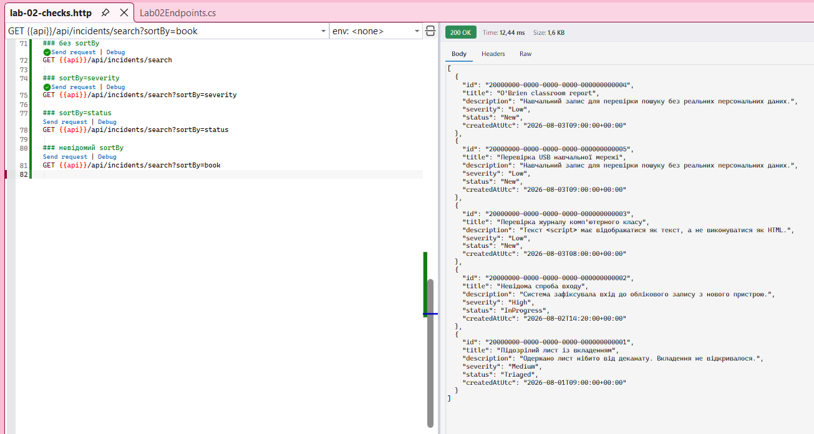
- sortBy=severity: спочатку High (0002), потім Medium (0001) і останніми Low (0003, 0004, 0005)  

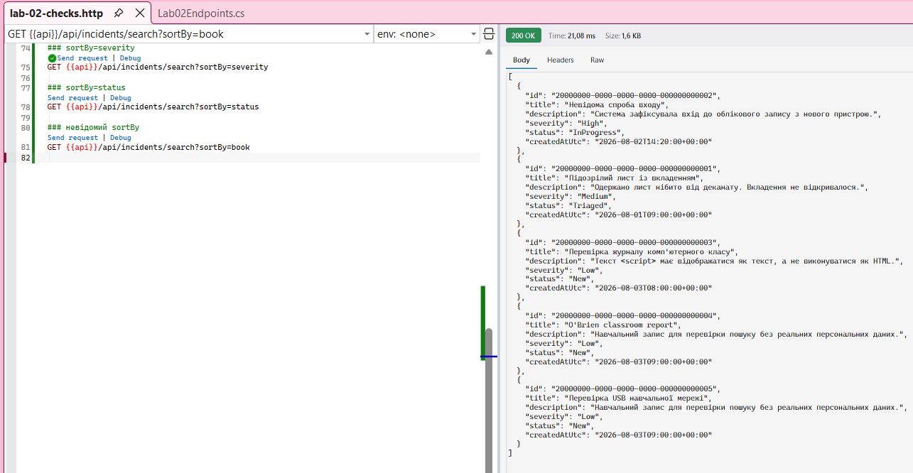
- sortBy=status: спочатку New (0003, 0004, 0005), далі Triaged (0001) і InProgress (0002)  

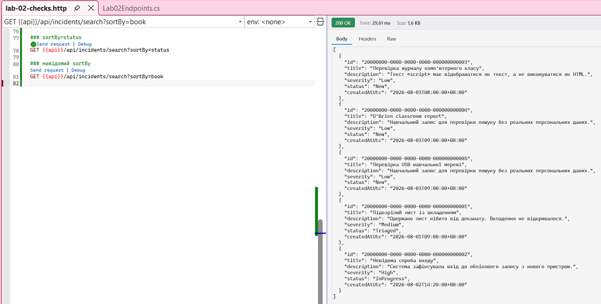

**Таблиця огляду для A-01**

| Файл/метод | Категорія | Висновки | 
|---|---|---|
| DatabaseBootstrap.cs (рядок 29), виклик ExecuteSqlRawAsync під час скидання бази | Статичний службовий SQL (виконує TRUNCATE). Дані від користувача туди взагалі не потрапляють | Безпечно. Цей файл я не змінювала, оскільки ризик ін'єкції відсутній | 
| Lab02Endpoints.cs (обробник пошуку), стан vulnerable commit (рядки 26–29) | Пряма конкатенація параметрів q та sortBy у сирий запит через FromSqlRaw | Уразливо. Саме тут була SQL-ін'єкція, яка потребувала виправлення |
| Обробник пошуку, стан fixed commit | Використання безпечного LINQ, методу ILike із параметризацією та жорсткий allowlist для сортування | Безпечно. Усі небезпечні SQL-конкатенації повністю прибрано з коду |

**Додаткова перевірка (пошук літералу SELECT):**

Для перевірки я використала пошук git grep за словом SELECT. На старому (vulnerable) коміті очікувано знайшовся проблемний 26-рядок. 
На виправленому (fixed) коміті вивід пошуку виявився порожнім. Отже, у коді пошуку SQL-конкатенацій більше немає

**Фінальні перевірки коду:**

Після останньої зміни я виконала збірку проєкту (build) та запустила всі автотести командою dotnet test. Повний прогін пройшов успішно: Total: 7; Failed: 0. 

Докази: 

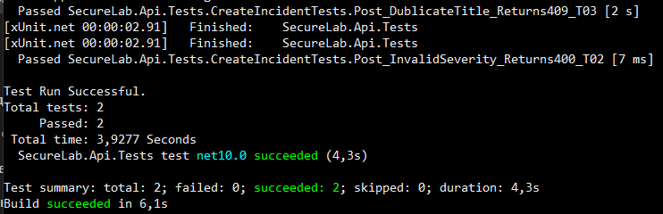

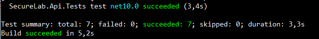

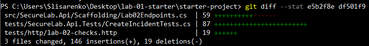

## 5. Обмеження і висновок

У ході виконання роботи було успішно ліквідовано вразливість до SQL-ін'єкції в пошуковому ендпоінті. 
Сиру конкатенацію рядків замінено на параметризований запит за допомогою EF.Functions.ILike, а для параметрів сортування впроваджено суворий список дозволених значень (allowlist). 
Також додано серверну валідацію вхідних даних через DTO, яке захищає систему від передачі непередбачених полів та гарантує виконання 
бізнес-правил (перевірки на довжину, діапазон значень Enum та крос-полеві обмеження).

Щодо недоліків та обмежень поточного коду: механізм перевірки дублікатів через AnyAsync надійно працює лише при послідовних запитах. 
У випадку одночасного (паралельного) створення інцидентів можливий стан гонитви (race condition), який дозволить створити дублікати. 
Для гарантованої унікальності цю перевірку варто перенести на рівень бази даних, додавши унікальний індекс. 
Під час перевірки CP-01 через пропущену лапку JSON був зламаний, і сервер відповів 500 замість 400, а запит не дійшов до моєї валідації. Цю поведінку я не виправляла й причину детально не досліджувала

## 6. Декларація використання ШІ

Якщо не використовували: «Генеративний ШІ не використовувався». Інакше:

| Сервіс | Задачі | Авторська адаптація/інтерпретація | Фактична перевірка |
|---|---|---|---|
| Claude | Розбір методичних рекомендацій і плану виконання; підказки щодо консольних команд Git і .NET; перевірка мого коду (валідація, LINQ ILike, тести), який базувався на прикладах з методички; пояснення причин помилок збірки та HTTP-запитів | Основний код брала з прикладів у методичці та адаптувала під завдання. З допомогою знайшла та виправила помилку в DTO відповіді (поверталось 2 поля замість 6). Склала власні тестові сценарії в lab-02-checks.http (перевірка меж у 39/40 символів, дублікати) | Ручне виконання .http запитів, перевірка журналу SQL до та після виправлення вразливості, відтворення вразливості та ретест, контроль репозиторію через Git-команди |
| Gemini | Допомога з формулюванням висновків та фінальним оформленням звіту | Запропонував чернетки формулювань, які я відредагувала | Перечитала звіт на логічну цілісність та відповідність вимогам перед фінальним комітом |

## 7. Передавання

- Remote доступний викладачеві або bundle перевірено через verify/list-heads: посилання надано.
- У Moodle файли/докази видимі й роботу надіслано: виконано.
- Git diff та історію перевірено на секрети: виконано.
