# Звіт WEB ЛР03

## Відтворення (усі рівні)

- Обраний рівень: "Добре".
- Автор і група: Слісаренко Анастасія Володимирівна, КБ-42.
- Baseline 2-A. Робота починається від тега v0.2.0 (коміт 7677d8dac48b1527c74cf6401473568d4afa1d01).
- Scaffold: release lab-03-start-v1, base_commit і entry_parent збігаються з комітом тега v0.2.0 (файл `.scaffolds/lab-03.json`).
- Гілка: lab/3-authentication. Перевірений коміт і тег v0.3.0: -.
- Середовище: Windows, Docker Desktop з PostgreSQL, .NET SDK 10.0.403.
- Команди збірки й тестів: `dotnet build SecureLab.sln -c Release` і `dotnet test tests/SecureLab.Api.Tests -c Release`.
- Фактичний результат: збірка проходить, у повному прогоні 19 тестів, жоден не впав.
- Міграція й reset: міграцію застосовує сам застосунок під час запуску; базу скидала командою `dotnet run --project src/SecureLab.Api -- --reset-database` двічі поспіль, обидва рази рядок про очищення seed-даних виводився, після чого тести проходили.
- Ключові коміти: 4a07e3f (scaffold), 47e0e42 (захист створення інциденту), 42edbcd (тести A-01…A-07), 75cd6f3 (обмеження входів і події), 9da4c65 (браузерний сценарій), решта комітів (register, logout, /api/me, cookie flags) видно в `git log`.

Scaffold я встановила скриптом `install.py`: спершу пробний запуск без змін, потім запис. Його файли лежать в окремому коміті, щоб було видно, що саме додано мною.

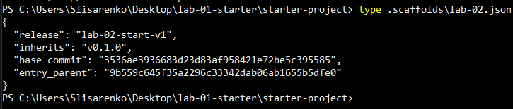

*Рисунок 1. Квитанція scaffold: release і base_commit.*

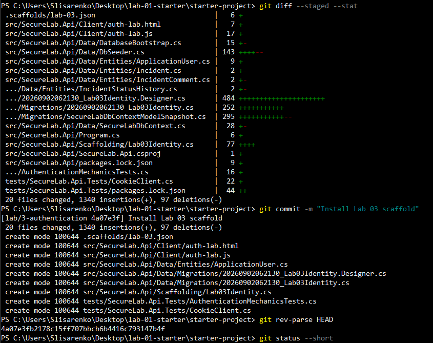

*Рисунок 2. Коміт зі scaffold.*

Пароль навчальних акаунтів я нікуди не записувала: він передається змінною середовища `SeedUsers__Password`, яка живе лише у відкритому вікні PowerShell. Перша спроба reset закінчилась помилкою `PasswordTooShort`, бо мій пароль був коротший за 10 символів. Після довшого пароля все пройшло.

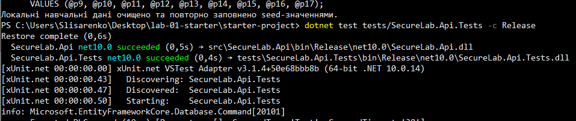

*Рисунок 3. Два виклики `--reset-database` і запуск тестів.*

### Стан до змін

До моїх змін усі початкові тести проходили, але система була навмисно вразливою: `/api/me` без входу відповідав 501 і довіряв заголовку `X-Demo-UserId`, а `logout` був заглушкою з тим самим 501.

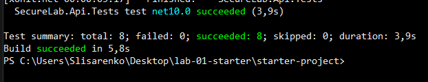

*Рисунок 4. Початкові 8 тестів проходять.*

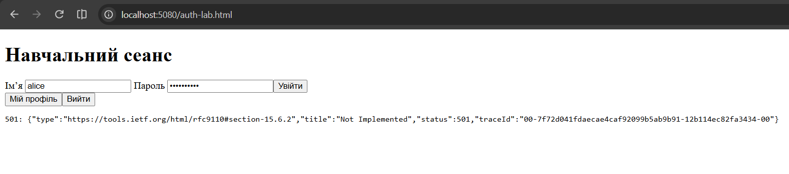

*Рисунок 5. До змін `/api/me` відповідає 501.*

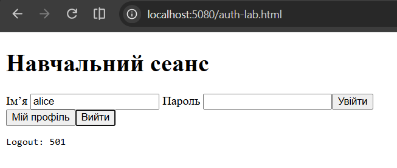

*Рисунок 6. До змін `logout` відповідає 501.*

## Власна реалізація і межі (усі рівні та позначені доповнення)

**DTO boundary.** Реєстрація приймає лише чотири поля: ім’я користувача, email, відображуване ім’я та пароль. Відповідь на успішну реєстрацію містить тільки `Id`, `UserName` і `DisplayName`, без хеша пароля, штампа безпеки чи ролі. `/api/me` теж повертає лише ці три поля. Об’єкт для створення інциденту взагалі не має поля власника.

**Звідки /api/me та create беруть id.** З перевіреної cookie: сервер читає `ClaimTypes.NameIdentifier` з `HttpContext.User`. Заголовок `X-Demo-UserId` і поле `ownerUserId` у JSON сервер не читає взагалі. Якщо claim відсутній або не є коректним Guid, відповідь 401.

**Cookie options і межа HTTP (усі).** Cookie входу має `HttpOnly` (скрипт сторінки її не прочитає, тож XSS не вкраде сеанс) і `SameSite=Lax` (браузер не надсилає її з чужих сайтів у POST-запитах). Політика `Secure` залежить від середовища: у Development вона `SameAsRequest`, тобто по HTTP cookie не отримує ознаки Secure, а поза Development діє `Always`, і cookie ходить лише по HTTPS. Отже, локально трафік відкритий, а в реальному середовищі його має закривати HTTPS. Ще я замінила перенаправлення на сторінку входу на статуси 401 і 403, щоб API не віддавало HTML.

**Фактичні flags (добрий).** Окремий тест виконує вхід по HTTPS і перевіряє в заголовку `Set-Cookie` лише атрибути: `httponly`, `secure`, `samesite=lax`, `path=/`. Значення cookie тест не виводить: для перевірки береться тільки частина рядка після першої крапки з комою. Межа цього тесту в тому, що він іде у режимі Development, а політику `Always` для production окремо я не запускала.

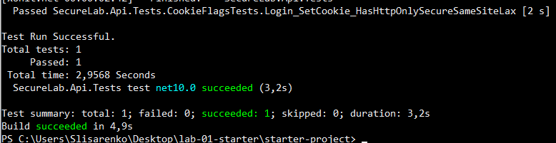

*Рисунок 7. Тест атрибутів cookie проходить.*

**Строк дії.** Стандартний для Identity, налаштувань строку я не змінювала.

**Однакові login-відмови (усі; автотест A-07 від "Добре").** Невідомий користувач і хибний пароль отримують однакову відповідь 401 з однаковим тілом, тому за відповіддю не можна дізнатися, чи існує акаунт. Тіла в тесті порівнюються без `traceId`, бо він унікальний для кожного запиту.

**Обраний duplicate-контракт (добрий).** Якщо ім’я користувача або email уже існують, реєстрація відповідає 409 з завжди однаковим повідомленням, а решта помилок (слабкий пароль, некоректне ім’я чи email) дає 400 з кодами Identity, але без пароля й без тіла запиту. Компроміс: відповідь 409 дозволяє стороннім перевірити, чи є такий акаунт. Я прийняла це, бо така відповідь корисніша справжньому користувачеві, і записала це серед обмежень нижче. Регресію забезпечує тест T-02.

**Rate partition, window, recovery і події (добрий).** Вхід захищено вбудованим RateLimiter ASP.NET Core: фіксоване вікно, 10 спроб за 10 секунд, без черги. Ключем групи я обрала IP-адресу клієнта. Ключ з іменем користувача гірший, бо стороння людина могла б навмисно "вичерпати" ліміт чужого акаунта й заблокувати його. Недолік IP-ключа в тому, що користувачі за спільною адресою ділять одну квоту. Після перевищення сервер повертає 429 без жодних деталей. Вікно в 10 секунд обране свідомо коротким, щоб відновлення можна було перевірити в автотесті за пристойний час. Журнал події входу містить тип події, результат (успіх чи відмова) і trace id. Ім’я користувача я навмисно не пишу в журнал: люди іноді вводять пароль у поле імені, і журнал міг би зберегти його відкритим текстом.

**CSRF навчальний борг.** Захист від CSRF тут зводиться до `SameSite=Lax`. Антифорджері-токенів немає, і це свідомий борг навчальної роботи: у реальній системі запити, що змінюють дані, треба додатково захищати токенами.

## Докази

Тут я пояснюю, як усе влаштовано, а нижче збираю результати перевірок в одну таблицю.

**Маршрут довіри.** Сервер нікому не вірить на слово. Під час входу він перевіряє пароль через `SignInManager.PasswordSignInAsync`: Identity порівнює введений пароль із хешем, який зберігає в таблиці користувачів, власної криптографії я не писала. Після успішної перевірки сервер видає cookie, і далі особу визначає лише ця cookie. Будь-що, що надсилає клієнт у заголовку чи тілі (наприклад, id або ownerUserId), для рішення про особу не використовується.

**Чому клієнтський UserId не є доказом особи.** Клієнт контролює все, що надсилає: будь-хто може написати в заголовку чужий id. У перевірці A-03 я увійшла як Alice і додала заголовок з id Bob, а відповідь залишилась про Alice. Саме тому id для `/api/me` і для створення інциденту береться лише з перевіреної cookie.

**Стандартна перевірка пароля.** Пароль хешує й перевіряє Identity, поріг довжини 10 символів налаштовано в Identity. Це підтверджує схема таблиці користувачів: хеш лежить у текстовому стовпці `PasswordHash`, а стовпця з відкритим паролем немає.

**Endpoint-и перебору акаунтів та компроміси.** Вхід не розкриває, чи існує акаунт (однакова 401), і обмежений за частотою. Реєстрація розкриває існування імені чи email через 409, і від цього я не захищалась: це компроміс між зручністю користувача та приватністю, а обмеження частоти на реєстрацію в роботі немає.

| ID | Рівень | Передумова/дія | Очікувано | Фактично | Безпечний доказ |
|---|---|---|---|---|---|
| T-01 | достатній | реєстрація нового користувача | safe 201 | Успішно повернуто статус 201 Created. У тілі відповіді присутні лише безпечні поля: `id`, `userName`, `displayName`. | [t01-t02-register](evidence/t01-t02-register.png) |
| T-02 | достатній | повторна реєстрація тих самих даних | safe rejection | Запит відхилено зі статусом 409 Conflict. Текст повідомлення ідентичний для всіх дублікатів, пароль не розкривається. Автотест пройдено. | [t01-t02-register](evidence/t01-t02-register.png), [register-tests-run](evidence/register-tests-run.png) |
| T-03 | достатній | схема таблиці користувачів і перевірка Identity | password не відкрито | Схема бази даних підтверджує наявність лише стовпця `PasswordHash`. Збереження пароля у відкритому вигляді відсутнє. | [t03-schema](evidence/t03-schema.png) |
| A-01 | достатній | анонімний запит до захищеного endpoint | 401, no redirect | Анонімні запити до `/api/me` та створення інцидентів відхиляються зі статусом 401 Unauthorized без HTTP-перенаправлень. | [a01-me-anon](evidence/a01-me-anon.png), [a01-create-anon](evidence/a01-create-anon.png) |
| A-02 | достатній | login, потім `/api/me` | principal user | Після автентифікації користувача (Alice) ендпоінт `/api/me` успішно повертає лише безпечні дані профілю. | [me-alice](evidence/me-alice.png) |
| A-05 | достатній | Bob створює запис із forged owner Alice | новий owner = Bob; зайве поле ігнорується | Перевірка в базі даних підтверджує, що власником створеного інциденту став поточний користувач (Bob), а переданий у запиті чужий ідентифікатор було проігноровано. | [a-tests-run2](evidence/a-tests-run2.png) |
| S-01 | достатній | аналіз credentials boundary | без витоків | Аудит репозиторію не виявив жорстко закодованих паролів у файлах чи історії комітів. Секретні дані також відсутні у відповідях API та журналах. | [s01-checklist](evidence/s01-checklist.png) |
| A-03/04/06/07 | добрий | окремий запис на кожний виконаний ID | контракт методички | Сервер ігнорує підроблені ідентифікатори в заголовках (A-03) та автоматично встановлює власником поточного користувача з сесії (A-04). Після логауту доступ надійно блокується з кодом 401 (A-06). Спроби входу з хибним паролем або неіснуючим логіном повертають абсолютно ідентичну відмову 401 (A-07). | [a03-header-no-cookie](evidence/a03-header-no-cookie.png), [a03-probe](evidence/a03-probe.png), [browser-4-logout](evidence/browser-4-logout.png), [me-after-logout](evidence/me-after-logout.png), [a-tests-run1](evidence/a-tests-run1.png), [a-tests-run2](evidence/a-tests-run2.png) |
| Browser flow | добрий | п’ять перевірок етапу 4 | state/profile/create/logout | Усі п'ять етапів браузерного сценарію успішно виконано (анонімний доступ, авторизація, створення ресурсу, вихід із системи та перевірка клієнтського сховища на відсутність витоків). | [browser-1-anon](evidence/browser-1-anon.png), [browser-1-network](evidence/browser-1-network.png), [browser-2-profile](evidence/browser-2-profile.png), [browser-3-create](evidence/browser-3-create.png), [browser-4-logout](evidence/browser-4-logout.png), [browser-4-network](evidence/browser-4-network.png), [browser-5-storage](evidence/browser-5-storage.png) |
| Duplicate | добрий | обраний контракт і регресія | послідовний 400/409 | Усі спроби реєстрації існуючих акаунтів стабільно дають 409 Conflict. Відсутність регресії підтверджено автотестом T-02. | [register-tests-run](evidence/register-tests-run.png) |
| Cookie flags | добрий | тест фактичних flags | контракт фіксованого профілю | Автотест успішно верифікував наявність обов'язкових захисних атрибутів: `httponly`, `secure`, `samesite=lax`, `path=/`. | [cookie-flags-test](evidence/cookie-flags-test.png) |
| Rate limit і події | добрий | перевищення ліміту, відновлення, аналіз події | 429, відновлення після вікна, без credentials | Зафіксовано блокування 429 Too Many Requests після 10 невдалих спроб. Доступ успішно відновлюється після 10-секундного вікна. У системних логах подія відмови фіксується безпечно, без розкриття імені користувача чи введеного пароля. | [rate-limit-test](evidence/rate-limit-test.png), [auth-event-log](evidence/auth-event-log.png) |

Обґрунтування partition key і виключених полів події: ключ IP я обрала, бо ключ з іменем користувача дозволив би стороннім заблокувати чужий акаунт; з події виключене ім’я користувача, бо воно може бути випадково введеним паролем. Threat analysis не входить до обраного рівня.

### Докази по етапах

**Реєстрація.** Ручна перевірка: перша реєстрація повертає 201, повтор тієї самої реєстрації повертає 409.

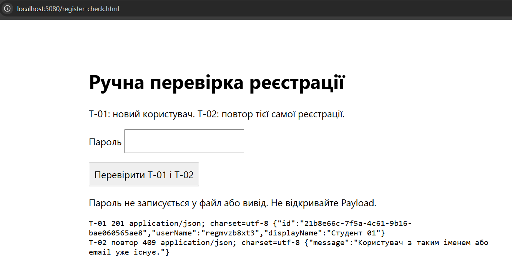

*Рисунок 8. T-01 (201) і повтор T-02 (409).*

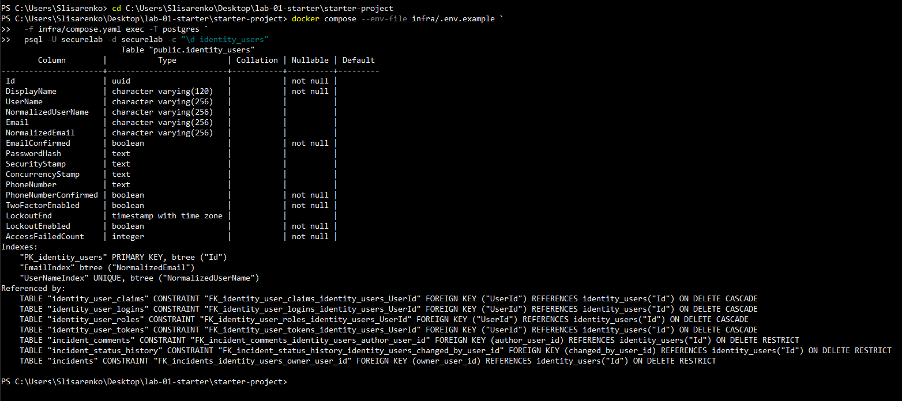

*Рисунок 9. Таблиця `identity_users`: хеш у `PasswordHash`, відкритого пароля немає.*

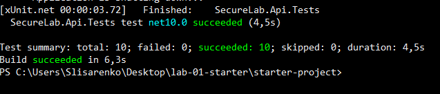

*Рисунок 10. Автотести реєстрації та решта тестів проходять.*

**Вхід, `/api/me`, вихід.** Без входу `/api/me` відповідає 401, і запит з чужим заголовком, але без cookie, теж 401. Після входу як alice профіль повертає лише безпечні поля.

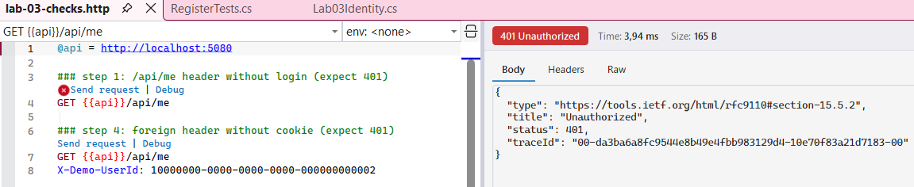

*Рисунок 11. Без входу: 401.*

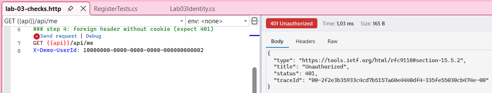

*Рисунок 12. Чужий `X-Demo-UserId` без cookie: 401.*

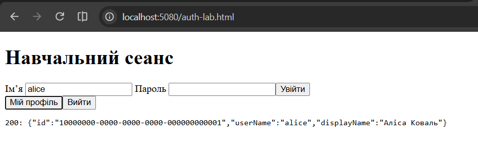

*Рисунок 13. Після входу: 200 і дані Alice.*

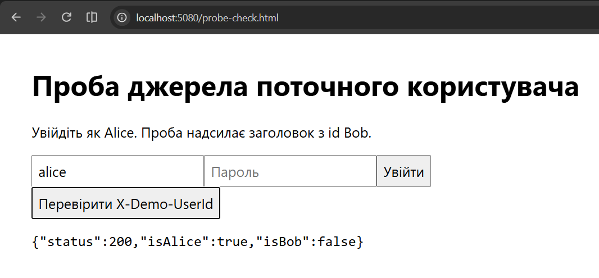

*Рисунок 14. Cookie Alice і заголовок Bob: відповідь лишається про Alice.*

Вихід раніше був заглушкою, тепер викликає `SignOutAsync` і повертає 204. Після виходу сервер видаляє cookie, тому наступний запит до `/api/me` знову дає 401.

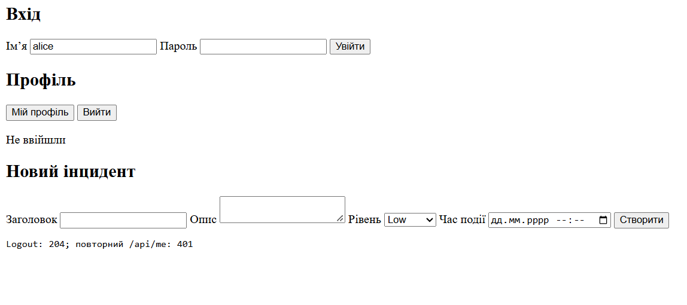

*Рисунок 15. Вихід: 204.*

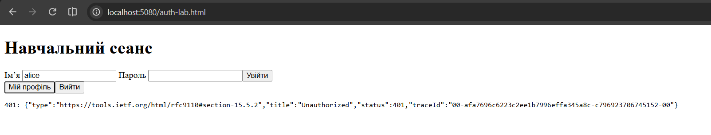

*Рисунок 16. Після виходу: 401.*

**Створення інциденту.** Створення стало захищеним: анонімний запит отримує 401, а власник береться з cookie, а не з тіла запиту. Тести ЛР 2 довелося змінити, бо тепер вони створюють інциденти від імені залогіненого користувача.

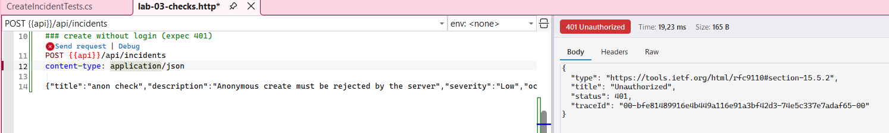

*Рисунок 17. Створення інциденту без входу: 401.*

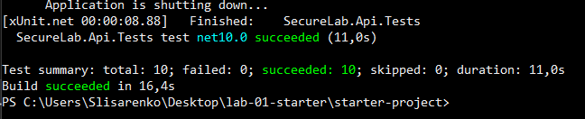

*Рисунок 18. Тести створення інциденту проходять від імені залогіненого користувача.*

**Автоматизовані тести A-01…A-07.** Тести перевіряють: анонім дає 401 без перенаправлення (A-01), після входу `/api/me` повертає цього користувача (A-02), чужий заголовок нічого не змінює (A-03), створення без власника записує поточного користувача (A-04), підроблений `ownerUserId` ігнорується (A-05), після виходу запит дає 401 (A-06), невідомий користувач і хибний пароль відмовлені однаково (A-07). Власників у A-04 і A-05 тест перевіряє напряму в базі.

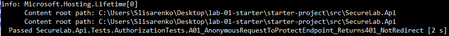

*Рисунок 19. Тести A-01…A-07, початок виводу.*

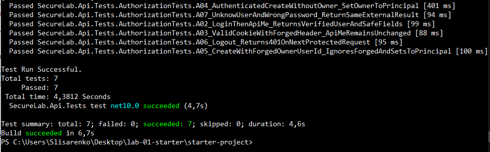

*Рисунок 20. Тести A-01…A-07, підсумок: усі пройшли.*

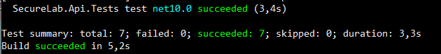

*Рисунок 21. Повний прогін: 19 тестів, жоден не впав.*

**Обмеження входів і події.** Тест робить 10 невдалих входів (кожен 401), 11-й запит отримує 429, а в тілі відповіді немає ні імені, ні слова password. Потім тест чекає 10,5 секунди, і вхід з правильним паролем знову проходить. Подія входу пишеться в журнал без імені користувача й пароля.

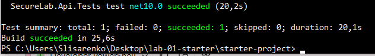

*Рисунок 22. 429 після 10 спроб і відновлення після вікна.*

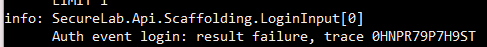

*Рисунок 23. Подія входу: тип, результат і trace id, без імені й пароля.*

**Браузерний сценарій.** Сторінка `auth-lab` має форми реєстрації, входу й створення інциденту та кнопки профілю й виходу. Вона нічого не зберігає в `localStorage` чи `sessionStorage`, не використовує `innerHTML` (лише `textContent`), очищає поле пароля після кожної спроби й збирає DTO для створення вручну з чотирьох полів, без власника.

1. Відкрила сторінку без входу: показано "Не ввійшли", у Network запит `/api/me` дає 401.

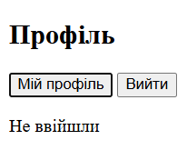

*Рисунок 24. Сторінка без входу.*

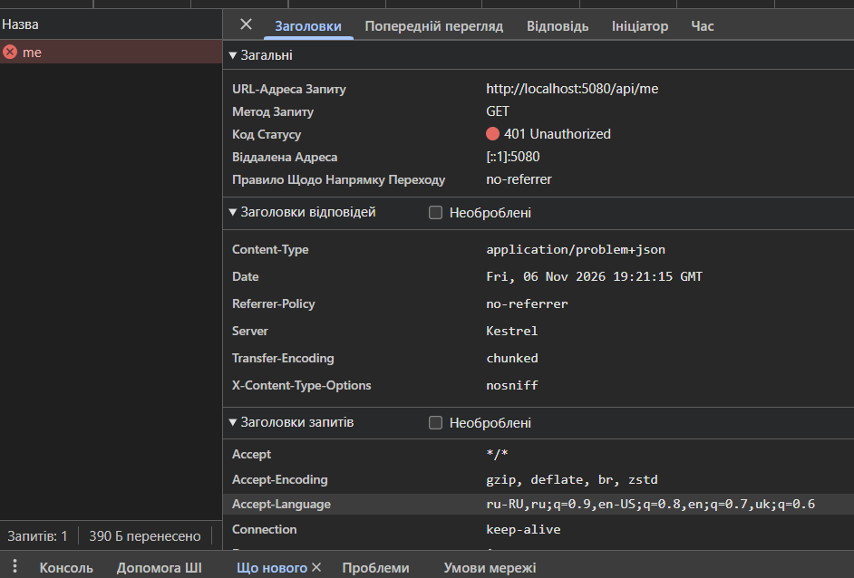

*Рисунок 25. `/api/me`: 401.*

2. Увійшла як alice: показано "Сеанс активний" і лише безпечні поля профілю.

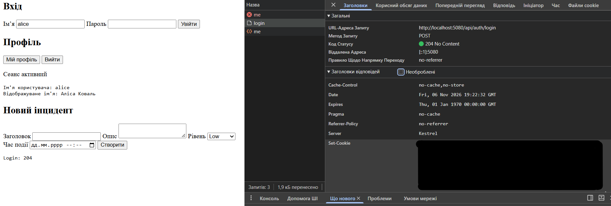

*Рисунок 26. Профіль після входу.*

3. Створила інцидент: відповідь 201.

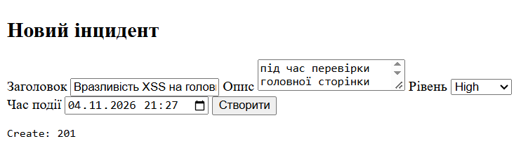

*Рисунок 27. Створення інциденту: 201.*

4. Вийшла: профіль прибрано, повторний `/api/me` дає 401.

*Рисунок 28. Вихід і повторний `/api/me`: 401.*

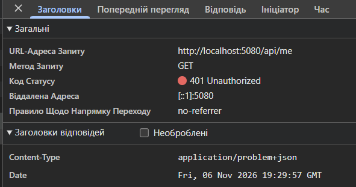

*Рисунок 29. Після виходу `/api/me`: 401.*

5. Перевірила сховище браузера: у Local Storage і Session Storage немає збережених даних.

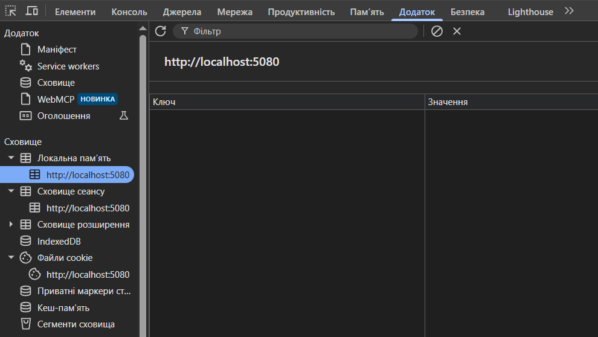

*Рисунок 30. Local Storage порожнє.*

**Перевірка на витоки (S-01).** Я шукала значення пароля у файлах репозиторію без друку (`git grep -q`), результат: не знайдено. Пошук по всій історії (`git log -S`) не показав жодного коміту. У списку файлів Git немає `.env`, `bin`, `obj`, `.bak`, `.sql` чи дампів. Відповіді API, події журналу та скріншоти не містять пароля, значення cookie, хеша чи токенів.

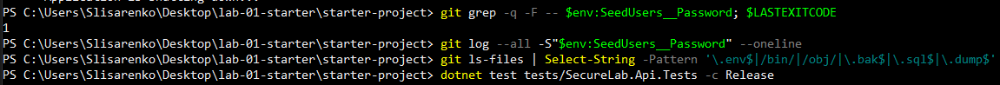

*Рисунок 31. Перевірка на витоки: пароль не знайдено у файлах і в історії.*

## Висновок

У цій роботі довіру до клієнтського ідентифікатора замінено на особу, яку перевіряє сервер. Реєстрація повертає безпечну відповідь і однаково реагує на дублікати, вхід однаково відмовляє на невідомого користувача й хибний пароль та обмежений за частотою, а `/api/me` і створення інциденту беруть особу лише з cookie. Вихід справді знищує сеанс. Усе це перевірено ручними запитами, браузерним сценарієм і 19 автоматизованими тестами.

Обмеження, які я залишила: захист від CSRF зводиться до `SameSite=Lax` без антифорджері-токенів; відповідь 409 при реєстрації дозволяє перевіряти, чи існує акаунт; лімітер працює лише для входу, лічить усі спроби, зберігається в пам’яті одного екземпляра застосунку й залежить від IP; у режимі Development cookie не має ознаки Secure для HTTP-запитів; блокування акаунта після невдалих спроб не використовується.

## Декларація використання ШІ (усі рівні)

ШІ використано. Сервіс: Claude (Anthropic). Що адаптовано автором: я підставила запропоновані фрагменти в свій проєкт, дописала й переписала власну частину коду (перевірки реєстрації, обробка дубліката, DTO, тести A-03…A-07, тест обмеження входів, обробники сторінки), змінила коментарі й назви, ухвалила власні рішення (контракт дубліката, ключ і межі ліміту, поле, яке не логується). Як перевірено твердження/код: запускала запити вручну, порівнювала відповіді з очікуваним, аналізувала помилки збірки й тестів, відновлювала пошкоджене середовище, перевіряла результати повним прогоном тестів і перевіркою на витоки.

| Дата | Сервіс/модель, якщо відома | Завдання або короткий запит без секретів | Використана частина відповіді | Авторська адаптація | Перевірка і фактичний результат |
|---|---|---|---|---|---|
| 11.2026 | Claude (Anthropic) | Розбір вимог методички та порядку етапів, команди Git, Docker, .NET | Покрокові команди й порядок виконання | Виконувала команди сама, підставляла свої шляхи й назви | Результати команд, скріни |
| 11.2026 | Claude (Anthropic) | Реєстрація: вимоги до валідації, перегляд мого коду | Пропозицію винести обрізані значення в локальні змінні й переробити коментарі | Код перевірок, дубліката й DTO написала сама, пропозицію прийняла | Збірка, тести T-01 і T-02, ручна перевірка 201 і 409 |
| 11.2026 | Claude (Anthropic) | Вихід, `/api/me`, захист створення інциденту | Чернетки змін для logout, `/api/me` і створення інциденту | Вставила в код, вирішила повертати 401 для відсутнього користувача, виправила помилку збереженого файла | Збірка, тести A-01…A-07, ручні запити |
| 11.2026 | Claude (Anthropic) | Обмеження входів і журнал подій | Каркас політики RateLimiter і запису події | Обрала власні значення й обґрунтування, написала тест 429 і відновлення | Тест проходить, журнал без секретів |
| 11.2026 | Claude (Anthropic) | Тести A-01…A-07, тест cookie flags | Заготовки A-01, A-02 і cookie flags, вимоги до решти | Самостійно написала A-03…A-07 і тест обмеження, виправила помилки компіляції | Повний прогін, 19 тестів без помилок |